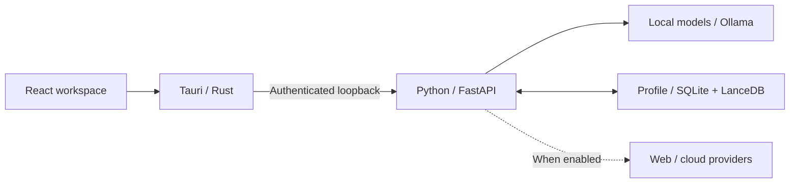

<p align="center">
  
</p>

<h1 align="center">LocalMind</h1>

<p align="center">
  <strong>A desktop workspace for local AI.</strong><br>
  Chat with your models. Ask your documents. Keep a small chat beside your work.
</p>

<p align="center">
  <a href="https://github.com/Swarneil1905/LocalMind/releases/latest"><strong>Download</strong></a> ·
  <a href="https://swarneil1905.github.io/LocalMind/"><strong>Watch the demo</strong></a> ·
  <a href="#contribute"><strong>Build with us</strong></a> ·
  <a href="docs/USER_GUIDE.md">User guide</a>
</p>

<p align="center">
  <a href="https://github.com/Swarneil1905/LocalMind/releases/latest"></a>
  <a href="LICENSE"></a>
  <a href="https://github.com/Swarneil1905/LocalMind/issues?q=is%3Aissue%20is%3Aopen%20label%3A%22good%20first%20issue%22"></a>
</p>

[](https://swarneil1905.github.io/LocalMind/)

<p align="center">
  <a href="https://swarneil1905.github.io/LocalMind/">Watch full-window chat and mini chat in your browser ↗</a><br>
  <sub>Windows walkthrough, v0.8.0. Real local-model responses, shortened pauses. Captions and fullscreen controls available.</sub>
</p>

LocalMind brings local models, document search and project context into one desktop app. Use the full workspace when you need room, or pin mini chat beside your editor, reading or notes. Local chat needs no LocalMind account or cloud AI subscription.

**Early-stage and open source.** Answer quality depends on the model and context. We are improving conversation reliability, model setup and desktop recovery, and welcome contributors who want to work on those problems.

## Get started

1. **[Download an installer](https://github.com/Swarneil1905/LocalMind/releases/latest)** for your computer.
2. **Choose and download a model** in setup. Ollama and the local AI service are bundled; model weights download separately.
3. **Start a conversation.** Follow up in the same chat, add a folder in Knowledge, or open mini chat to work beside it.

### Install

| Windows | macOS | Linux |
| --- | --- | --- |
| x64 `.exe` installer | Apple Silicon or Intel `.dmg`, macOS 14+ | x64 `.deb` or `.AppImage` |

**No Docker, Python, Node.js or Rust installation is needed to use the packaged app.** An existing local Ollama installation can be reused. Once models are installed, local chat and document retrieval can work offline.

The public release is **[v0.8.0](https://github.com/Swarneil1905/LocalMind/releases/tag/v0.8.0)**. The source tree includes the **[v0.9.0 candidate](docs/releases/v0.9.0.md)**. Source changes do not update an installed copy until you install a newer build.

<details>
<summary><strong>Model sizes, updates and installation notes</strong></summary>

| Default model | Use | Approximate download |
| --- | --- | --- |
| `qwen2.5:1.5b` | Speed preset and lightweight background work | 1 GB |
| `qwen3:8b` | Balanced preset | 5.2 GB |
| `nomic-embed-text` | Semantic document search | 274 MB |

Smaller models use fewer resources but can miss instructions and corrections. Download size is not runtime memory use; speed depends on your model, settings and hardware.

Updater bundles are signed with LocalMind’s update key. Windows Authenticode signing and Apple notarization are not configured, so your OS may show a security prompt. Releases include `SHA256SUMS.txt`.

See [installation and updates](docs/USER_GUIDE.md#install) and [model setup](docs/USER_GUIDE.md#get-started).

</details>

## What you can do

| When you want to… | Use LocalMind to… |
| --- | --- |
| Think through a question | Stream a local model’s answer with formatted code, tables and equations. Stop, retry or switch model presets. |
| Keep working beside a chat | Pin and resize mini chat, then return to the full workspace with the same conversation and draft. |
| Understand your files | Search a project’s documents and inspect cited passages with page or line locations. |
| Keep useful context | Review and remove saved memories, scoped to their project or originating conversation. |
| Organize a piece of work | Group chats into projects and review suggested tasks before creating them. |
| Look something up | Enable Web and inspect source links and available publication dates. Queries leave your device. |

Light, dark and system themes, visible keyboard focus and reduced-motion support are part of the interface. See [everyday controls](docs/USER_GUIDE.md#everyday-controls) for shortcuts.

## Contribute

**You do not need to understand the whole app to make a useful change.** A clearer error message, a keyboard fix or a regression test is a good place to start.

**[Find a good first issue](https://github.com/Swarneil1905/LocalMind/issues?q=is%3Aissue%20is%3Aopen%20label%3A%22good%20first%20issue%22)** · **[Browse help wanted](https://github.com/Swarneil1905/LocalMind/issues?q=is%3Aissue%20is%3Aopen%20label%3A%22help%20wanted%22)** · **[Contributor guide](CONTRIBUTING.md)**

| Your interest | Where to start |
| --- | --- |
| Interface and accessibility | Chat controls, previews and visual editors in [`apps/desktop/src`](apps/desktop/src). Frontend unit tests need no downloaded model. |
| Python and AI behavior | Context selection, retrieval and persistence in [`services/ai`](services/ai). Start with a small reproducible conversation. |
| Rust and desktop systems | Window behavior and process recovery in [`apps/desktop/src-tauri`](apps/desktop/src-tauri), or packaging in [`scripts/release`](scripts/release). |
| Writing and usability testing | Improve a setup step or try the [tester checklist](docs/product/tester-checklist.md). Documentation changes do not require installing the app. |

Check the issue discussion and [open PRs](https://github.com/Swarneil1905/LocalMind/pulls), then leave a comment with your approach. Coordinate with anyone already working on it. Keep your first PR focused on one observable improvement.

AI-assisted contributions are welcome. [Disclose tools and scope](docs/AI_CONTRIBUTIONS.md), read your final diff and report what you actually tested. A paid review tool is not required. Use the [PR template](.github/pull_request_template.md) and [review guide](docs/REVIEWING.md).

## Development

The app uses **React + TypeScript**, **Tauri + Rust**, **Python + FastAPI**, **SQLite + LanceDB**, and **Ollama**. Each installation runs its own local service and profile. There is no hosted team backend or automatic device sync.



**[Follow a chat message through the codebase →](docs/CODEBASE.md#follow-one-chat-message)**

For frontend-only work, with **Node.js 22 and pnpm 11.0.9** installed:

```sh
git clone https://github.com/Swarneil1905/LocalMind.git
cd LocalMind
pnpm install --frozen-lockfile
pnpm --filter desktop test
```

To submit changes, [fork the repository first](CONTRIBUTING.md#set-up-your-fork). To run the full app, follow [desktop setup](apps/desktop/README.md): Python 3.11, Rust stable, [Tauri’s native prerequisites](https://v2.tauri.app/start/prerequisites/), system Ollama and the development sidecar step are also required. Use a [separate development profile](CONTRIBUTING.md#use-a-development-profile).

[](https://github.com/Swarneil1905/LocalMind/actions/workflows/ci-frontend.yml)
[](https://github.com/Swarneil1905/LocalMind/actions/workflows/ci-python.yml)
[](https://github.com/Swarneil1905/LocalMind/actions/workflows/ci-rust.yml)
[](https://github.com/Swarneil1905/LocalMind/actions/workflows/release.yml)

Releases repeat CI checks, build on native Windows/macOS/Linux runners, test installer contents and verify updater signatures. See [release engineering](docs/RELEASING.md) and [conversation evaluation](evaluation/README.md). Passing tests does not establish answer quality. Evaluation conversations **do not train the model**.

## Your data

Local chat, memory and document retrieval run on your device. LocalMind does not send product analytics. Web search sends queries to a search provider; optional cloud chat and media send approved inputs to the selected provider. Cloud chat starts disabled and uses your own API account.

Credentials use the native OS credential store with no plaintext fallback. Profile databases rely on OS account permissions and are **not encrypted by LocalMind**. People sharing an OS account share its default profile. Model downloads and update checks contact their respective hosts.

Read [data destinations and storage paths](docs/USER_GUIDE.md#your-data), [cloud chat setup](docs/cloud-chat.md) and the [security policy](SECURITY.md).

## Optional and experimental features

These features have narrower support than core local chat. Check their guides before relying on them.

| Feature | Status and limits |
| --- | --- |
| Attachments and cloud chat | v0.9.0 candidate. Screenshot/document input and optional OpenAI, Anthropic and Gemini APIs. Vision needs a compatible model. Native clipboard and live provider coverage are incomplete. [Guide](docs/cloud-chat.md). |
| Visual workspace | v0.9.0 candidate. Editable diagrams, revisions, charts and bounded learning widgets. Arbitrary generated applications remain disabled. [Guide](docs/visual-workspace.md). |
| Voice | Windows x64 English pilot, disabled by default pending microphone/playback checks. Mac/Linux voice is not implemented. [Guide](docs/voice.md). |
| Images and video | Local images disabled after quality review. Optional paid image APIs and Runway require approval; live provider acceptance remains pending. [Guide](docs/media.md). |
| Connections, MCP and plugins | Gmail read-only pilot, an owned MCP test server and built-in tools. No arbitrary third-party code or automatic chat tool execution. WhatsApp and iMessage are unavailable. [Guide](docs/connections.md). |
| Dependency repair | Track dependencies and review repair previews. File apply/restore is a Windows pilot with recovery receipts. [Code and tests](docs/CODEBASE.md). |

See the [full feature notes](docs/USER_GUIDE.md#optional-and-experimental-features) for downloads, cost limits and verification gaps, and [candidate release notes](docs/releases/v0.9.0.md) for update behavior and known answer-quality problems.

## Troubleshooting

The [user guide](docs/USER_GUIDE.md#troubleshooting) covers startup failures, slow models, Knowledge indexing and Windows installer file locks.

**[Report a bug](https://github.com/Swarneil1905/LocalMind/issues/new/choose)** with the app version, OS, model, reproduction steps and relevant errors. For a bad answer, include the smallest conversation that reproduces it. Remove private content and credentials; report vulnerabilities through [SECURITY.md](SECURITY.md).

## People and license

Thanks to everyone who reports a bug, tests a build, improves the docs or contributes code. See the [contributors](https://github.com/Swarneil1905/LocalMind/graphs/contributors) and [merged PRs](https://github.com/Swarneil1905/LocalMind/pulls?q=is%3Apr%20is%3Amerged) for the people and changes behind LocalMind.

LocalMind is [MIT licensed](LICENSE). Dependencies and downloaded models retain their own licenses.
