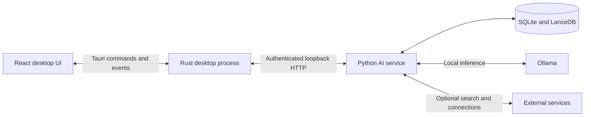

  

# LocalMind

**A desktop workspace for local AI, your files, and the things you want to remember.**

Chat with models running on your computer, search your documents, and keep conversations organized with projects and tasks. No LocalMind account or cloud AI subscription is required.

[Download](https://github.com/Swarneil1905/LocalMind/releases/latest) · [Demo](#see-it-in-action) · [Getting started](#getting-started) · [Development](#development) · [Report an issue](https://github.com/Swarneil1905/LocalMind/issues)

## See it in action

**[Watch or download the full walkthrough (MP4, 80 seconds, 4.1 MB)](https://github.com/Swarneil1905/LocalMind/raw/refs/heads/main/docs/media/localmind-walkthrough.mp4)**

A captioned tour of chat, sources, Knowledge, Memory, Projects, Tasks, and themes. The recording uses a sample workspace and example responses; it is a product tour, not a live model benchmark.

## What you can do

| Workspace | What it does |
| --- | --- |
| **Chat** | Stream responses from local models, switch model presets, stop a response, and retry a failed request. |
| **Sources** | Inspect links and available publication dates for web-assisted answers. Source details are saved with the conversation. |
| **Knowledge** | Index local documents and folders, then retrieve relevant passages during chat. Optional expanded search uses a generated draft answer to find related passages. |
| **Memory** | Review and remove facts extracted from conversations, including relationships between saved facts. |
| **Projects and Tasks** | Group conversations by project and track work alongside them. |
| **Connections** | Connect supported apps to bring their data into your workspace. Availability and setup depend on the service and operating system. |
| **Settings** | Choose installed models, download more models, configure web search, and switch between light and dark themes. |

LocalMind is built for independent desktop installations. Each person has their own local workspace, models, and connections. There is no shared server or automatic conversation sync between devices.

## Install

**[Open the latest published release](https://github.com/Swarneil1905/LocalMind/releases/latest)** and choose an installer from its assets.

This branch contains **0.7.0**. The latest published release may be older; the release page is the source of truth for available downloads. See the [0.7.0 release notes](docs/releases/v0.7.0.md) for the changes in this branch.

The 0.7.0 release workflow builds these installers:

| Computer | Installer |
| --- | --- |
| Windows x64 | `.exe` setup installer |
| macOS Apple Silicon, macOS 14 or later | `_aarch64.dmg` |
| macOS Intel, macOS 14 or later | `_x64.dmg` |
| Linux x64 | `.deb` or `.AppImage` |

The 0.7.0 installers include the Python AI service and Ollama runtime. You do not need to install Python, Node.js, Rust, or Docker to use them. If Ollama is already running locally, LocalMind uses it.

Model weights are downloaded separately. Allow disk space for both the installer and your chosen models; memory requirements and response speed depend on the model and your hardware.

Release assets include `SHA256SUMS.txt`. Update bundles are signed for LocalMind's updater; Windows installers are not Authenticode-signed and macOS apps are not Apple-notarized. Your operating system may display a security prompt.

## Getting started

1. **Launch LocalMind and finish model setup.** The first-run screen shows download progress and lets you retry failed downloads. An internet connection is required to download models.
2. **Choose a model and start a chat.** Settings lets you change which installed model each preset uses. Start with a smaller model if responses are slow.
3. **Add your files in Knowledge.** Install the embedding model before indexing documents. Ask a question about the files after indexing finishes.
4. **Review Memory.** Check the facts saved from conversations and remove anything you do not want reused.
5. **Enable web search when you need online information.** Choose DuckDuckGo or configure a SearXNG instance. LocalMind searches for source-dependent questions and answers ordinary explanations locally. Check the sources and their dates, especially for current events.

The setup screen currently offers these default models:

| Model | Purpose |
| --- | --- |
| `qwen2.5:1.5b` | Speed preset and background work such as memory extraction |
| `qwen3:8b` | Balanced and Boost presets by default; these can be changed in Settings |
| `nomic-embed-text` | Embeddings for Knowledge search |

Once models are installed, local chat and document retrieval can work offline. Web search, remote connections, model downloads, and update checks need their respective network services. Voice is not available in 0.7.0.

## Data and privacy

Model inference runs through Ollama on this computer. The AI service listens on loopback and requires a fresh token supplied by the desktop app for each launch.

| Data or activity | Where it goes |
| --- | --- |
| Conversations, memories, projects, and tasks | Local SQLite databases in your profile |
| Indexed documents | Local text/index data in SQLite and LanceDB |
| Web-assisted questions | Search queries, which can include context from follow-up questions, go to the selected search provider; LocalMind also fetches result pages |
| Saved web sources | Source links and available metadata stay with the local conversation |
| Connected apps | Authentication and sync communicate with the connected service; downloaded data and session credentials are stored locally |
| Model downloads | Ollama contacts the model registry |
| Update checks and downloads | The updater contacts GitHub Releases |

LocalMind has no built-in analytics or usage tracking. Local storage is protected by your OS account permissions, not by application-level encryption. Connector credentials are not stored in a native keychain. People using the same OS account share its default profile.

| Platform | Default profile directory |
| --- | --- |
| Windows | `%APPDATA%\LocalMind` |
| macOS | `~/Library/Application Support/LocalMind` |
| Linux | `$XDG_DATA_HOME/LocalMind`, or `~/.local/share/LocalMind` |

Ollama manages its model storage separately. See [desktop runtime and storage](docs/DESKTOP_RUNTIME.md) for process isolation, profile migration, and developer overrides.

## Troubleshooting

| Symptom | What to check |
| --- | --- |
| The local AI service does not start | Use the app's retry control after the failure. Close another LocalMind instance using the same profile; only one service can own it. |
| A chat model is unavailable | Finish its download or choose an installed model in Settings. Source development also requires a running local Ollama service. |
| Knowledge indexing or search fails | Check that `nomic-embed-text` is installed and the selected files are readable. |
| A current-news question has no answer | Verify web search is enabled. LocalMind reports when it cannot retrieve suitable dated sources; try a more specific query. |
| Responses are slow | Try a smaller installed model and disable expanded Knowledge search to reduce extra model calls. |

For a bug report, include the app version, operating system, model name, steps to reproduce, and relevant errors. Remove private conversation content and credentials before posting to [Issues](https://github.com/Swarneil1905/LocalMind/issues). Report security vulnerabilities using [SECURITY.md](SECURITY.md).

## Development

The repository uses **Node.js 22**, **pnpm 11.0.9**, **Python 3.11**, and **Rust stable**, matching CI. Native development also needs the [Tauri platform prerequisites](https://v2.tauri.app/start/prerequisites/) and a running local Ollama service.

See the [desktop development guide](apps/desktop/README.md) for virtual-environment setup, first-build preparation, and validation commands. Docker is not required for development or the release workflow.

| Directory | Responsibility |
| --- | --- |
| `apps/desktop/src` | React and TypeScript interface |
| `apps/desktop/src-tauri` | Rust desktop commands, lifecycle, and native packaging |
| `crates/` | Shared Rust runtime, database, and permission crates |
| `services/ai` | Python/FastAPI service, retrieval, memory, and connections |
| `scripts/release` | Runtime staging, packaging, smoke checks, and release validation |
| `.github/workflows` | Frontend, Python, Rust, and native release workflows |

Rust owns service startup, readiness, cancellation, and recovery. Python owns retrieval and persistence. Request-scoped streaming keeps replies attached to the conversation that started them.

### Checks and releases

The frontend, Python, and Rust workflows run on pushes to `main` and pull requests targeting `main`. They check types, lint, tests, builds, and release tooling. The Release workflow runs these checks again, builds on native runners, tests packaged service payloads, and verifies assets before publication.

Release preparation, signing, build-only runs, and failure recovery are documented in [Releasing LocalMind](docs/RELEASING.md). A failed release build does not make a new version available for download.

## Further reading

- [Product evaluation](evaluation/README.md): replay synthetic conversations against an installed local model, capture replies and timings, and review behavior with a fixed rubric.
- [Chat reliability](docs/CHAT_RELIABILITY.md): request handling, search freshness, and source persistence.
- [Desktop runtime](docs/DESKTOP_RUNTIME.md): per-user storage and service lifecycle.
- [Product design](docs/PRODUCT_REDESIGN.md): interface decisions and workspace behavior.
- [Releasing](docs/RELEASING.md): native packaging and publication.

## License

LocalMind is released under the [MIT License](LICENSE). Bundled dependencies and downloaded models retain their own licenses.
