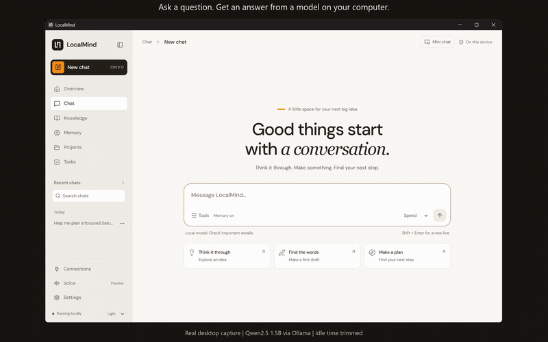
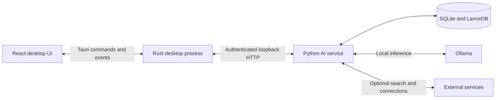

  

# LocalMind

**A desktop workspace for local AI, your files, and the things you want to remember.**

Chat with models running on your computer, search your documents, and keep conversations organized with projects and tasks. No LocalMind account or cloud AI subscription is required.

[Download](https://github.com/Swarneil1905/LocalMind/releases/latest) · [Demo](#see-it-in-action) · [Getting started](#getting-started) · [Development](#development) · [Report an issue](https://github.com/Swarneil1905/LocalMind/issues)

## See it in action

**[Watch or download the full walkthrough (MP4, 80 seconds, 4.1 MB)](https://github.com/Swarneil1905/LocalMind/raw/refs/heads/main/docs/media/localmind-walkthrough.mp4)**

A captioned tour of chat, sources, Knowledge, Memory, Projects, Tasks, and themes. The recording uses a sample workspace and example responses; it is a product tour, not a live model benchmark.

## What you can do

| Workspace | What it does |
| --- | --- |
| **Chat** | Stream responses from local models, render equations and code, copy answers or code, stop a response, and retry. Reading earlier messages keeps your scroll position. |
| **Sources** | Inspect web links and publication dates, or open local file citations to see the indexed passage and its PDF page or text lines. Changed and missing files are flagged. |
| **Knowledge** | Assign folders to a project and search their text and meaning. Unassigned chats search unassigned sources. Text search remains available when embeddings fail; indexing shows partial results and offers retry. |
| **Memory** | Review and remove facts extracted from conversations, including relationships between saved facts. |
| **Projects and Tasks** | Group conversations by project. Ask chat to add a task, review its title and date, and confirm creation. Saved receipts make repeated confirmations safe. |
| **Dependencies** | Capture selected text-file revisions, quote a supporting fact, and confirm which files or project tasks depend on it. Rescans show affected work. Review exact-value repair diffs, then apply accepted changes individually with backups and recovery receipts. File apply is a Windows pilot. |
| **Connections** | Connect supported apps to bring their data into your workspace. Availability and setup depend on the service and operating system. |
| **Settings** | Choose installed models, adjust context and supported thinking controls, restore previous response settings, configure web search, and switch themes. |

LocalMind is built for independent desktop installations. Each person has their own local workspace, models, and connections. There is no shared server or automatic conversation sync between devices.

These features describe the current source branch; a published installer may not include the latest changes. New memories are scoped to their project, or to the originating conversation when no project is selected. Relevant legacy global memories remain available. Review and remove saved facts in Memory.

## Install

**[Open the latest published release](https://github.com/Swarneil1905/LocalMind/releases/latest)** and choose an installer from its assets.

This branch contains **0.7.0**. The latest published release may be older; the release page is the source of truth for available downloads. See the [0.7.0 release notes](docs/releases/v0.7.0.md) for the changes in this branch.

The 0.7.0 release workflow builds these installers:

| Computer | Installer |
| --- | --- |
| Windows x64 | `.exe` setup installer |
| macOS Apple Silicon, macOS 14 or later | `_aarch64.dmg` |
| macOS Intel, macOS 14 or later | `_x64.dmg` |
| Linux x64 | `.deb` or `.AppImage` |

The 0.7.0 installers include the Python AI service and Ollama runtime. You do not need to install Python, Node.js, Rust, or Docker to use them. If Ollama is already running locally, LocalMind uses it.

Model weights are downloaded separately. Allow disk space for both the installer and your chosen models; memory requirements and response speed depend on the model and your hardware.

Release assets include `SHA256SUMS.txt`. Update bundles are signed for LocalMind's updater; Windows installers are not Authenticode-signed and macOS apps are not Apple-notarized. Your operating system may display a security prompt.

## Getting started

1. **Launch LocalMind and finish model setup.** The first-run screen shows download progress and lets you retry failed downloads. An internet connection is required to download models.
2. **Choose a model and start a chat.** Settings lets you change which installed model each preset uses. Start with a smaller model if responses are slow.
3. **Add your files in Knowledge.** Select their project, add a folder, and check its indexing status. Install `nomic-embed-text` for semantic search; exact-term search can work without embeddings. Enable Knowledge in the matching project chat, then open a `[K1]` citation to inspect its supporting passage.
4. **Review Memory.** Check the facts saved from conversations and remove anything you do not want reused.
5. **Enable web search when you need online information.** Choose DuckDuckGo or configure a SearXNG instance. LocalMind searches for source-dependent questions and answers ordinary explanations locally. Check the sources and their dates, especially for current events.

The setup screen currently offers these default models:

| Model | Purpose |
| --- | --- |
| `qwen2.5:1.5b` | Speed preset and background work such as memory extraction |
| `qwen3:8b` | Balanced preset by default; this can be changed in Settings |
| `nomic-embed-text` | Embeddings for Knowledge search |

Once models are installed, local chat and document retrieval can work offline. Web search, remote connections, model downloads, and update checks need their respective network services. Voice is not available in 0.7.0.

## Tasks and project dependencies

To create a task from chat, select its project in the chat header and ask, for example, **“Add a task called Review the launch draft, due 2026-11-18.”** LocalMind prepares a proposal using the local model. Check the destination, title and date, then choose **Create task**. A task is created only after confirmation; the card shows the saved task ID. Retrying the same confirmation returns the original receipt, even if the reply was lost. Dismissed proposals create nothing. Moving a chat to another project blocks its older pending requests.

In **Projects → Dependencies**:

1. Set the working folder in Overview and explicitly approve it for dependency tracking.
2. Capture a source using its relative path, such as `notes/release.md`.
3. Copy an exact quote from the captured source, explain the dependency, and choose a dependent text file or an existing task in that project.
4. Inspect the proposal and confirm or reject the link.
5. Choose **Rescan tracked files** after making edits. Changed sources or missing targets flag confirmed dependencies for review, with the original quote and reason still available.

Dependency tracking supports UTF-8 `.md`, `.markdown` and `.txt` files up to 256 KiB, with up to 200 sources and 200 links per project. It reads only registered files within the approved folder and excludes linked paths. A changed hash signals a revision difference, not proof that a fact's meaning changed. Results reflect the last scan.

After a source changes, **Prepare a repair preview** lets you specify an old value and its replacement, such as `2026-11-18` → `2026-11-25`. Both values must be verified against the captured and current source. LocalMind stages copies of confirmed dependent items, checks exact matches and unchanged target revisions, validates supported text/task constraints, and shows each before/after diff. Multiple matches, missing or modified targets, unsupported formats, and failed checks block that candidate. Markdown checks include balanced fenced code blocks; they do not prove semantic correctness.

Accepting or rejecting individual proposals saves review choices only. **Apply this change** opens a separate confirmation for one accepted item. The service rechecks its source and original revision, saves a durable backup and journal entry, and records a write receipt. Repeating the request returns that receipt instead of repeating the update. Multi-item repairs are not one atomic transaction: inspect each item's receipt for progress.

Local task updates and their journal records commit together in SQLite. File apply is enabled only on Windows, using handles that deny competing writes and deletes while the approved file is open. Mac/Linux file apply remains disabled because advisory locks cannot guarantee that another editor will cooperate. Set `LOCALMIND_REPAIR_APPLY=0` before launching the app to disable all apply/restore writes; previews and recovery checks remain available.

**Check recovery** compares current content with the saved original and intended revision without modifying it. **Restore original** requires another confirmation and refuses to overwrite a later edit. If interrupted content matches neither revision, the receipt reports a conflict and requires manual recovery. Original bytes remain in the local `projects.db` repair journal, with the original staged copy under `repair-staging/<operation-id>/<item-id>.before`. Preserve this profile when recovering work; do not delete it or the project before recovery. File writes preserve the existing file and its permissions but are not atomic during a process or power failure, which is why backups are committed first.

Repair previews and copies persist locally across restarts, with limits of 50 operations per project, 8 MiB of staged copies per operation, and 16 MiB of preview text per project. Captured source revisions stay fixed; automatic repair and accepting a new baseline revision are not implemented yet. A receipt reconciled as **not applied** or **restored** cannot be reused to apply again; prepare a new preview.

Task extraction uses [Ollama's structured output format](https://ollama.com/blog/structured-outputs), followed by local validation and explicit review. Model output can still be wrong, so review the proposal rather than treating its wording as a completed action.

## Voice controls preview

The source build includes a **Voice → Simulation** page. Choose a sample input and grant simulated permission, then hold **Hold to talk** or use **Start sample recording** and **Stop sample recording**. The recording indicator has a 30-second limit. Stop produces editable sample text; Cancel preserves the previous draft and discards only the new attempt. Leaving the page stops the simulation and clears its draft. Nothing is sent to chat automatically.

This is a controls prototype, not speech recognition: it never opens a real microphone, records audio, transcribes speech, or generates a spoken reply. Permission-denied and missing-device scenarios can be exercised on the page. Real microphone integration and local speech models are later work.

Developers can run `python scripts/evaluation/workspace_repair_gate.py` for ten isolated repair journeys. Its JSON evidence stays under ignored `artifacts/evaluation/`. The Windows Python CI job checks exclusive handles and real process interruptions; the full service suite also checks knowledge isolation and task creation.

## Data and privacy

Model inference runs through Ollama on this computer. The AI service listens on loopback and requires a fresh token supplied by the desktop app for each launch.

| Data or activity | Where it goes |
| --- | --- |
| Conversations, memories, projects, and tasks | Local SQLite databases in your profile |
| Indexed documents | Local text/index data in SQLite and LanceDB |
| Web-assisted questions | Search queries, which can include context from follow-up questions, go to the selected search provider; LocalMind also fetches result pages |
| Saved web sources | Source links and available metadata stay with the local conversation |
| Connected apps | Authentication and sync communicate with the connected service; downloaded data and session credentials are stored locally |
| Model downloads | Ollama contacts the model registry |
| Update checks and downloads | The updater contacts GitHub Releases |

LocalMind has no built-in analytics or usage tracking. Local storage is protected by your OS account permissions, not by application-level encryption. Connector credentials are not stored in a native keychain. People using the same OS account share its default profile.

| Platform | Default profile directory |
| --- | --- |
| Windows | `%APPDATA%\LocalMind` |
| macOS | `~/Library/Application Support/LocalMind` |
| Linux | `$XDG_DATA_HOME/LocalMind`, or `~/.local/share/LocalMind` |

Ollama manages its model storage separately. See [desktop runtime and storage](docs/DESKTOP_RUNTIME.md) for process isolation, profile migration, and developer overrides.

## Troubleshooting

| Symptom | What to check |
| --- | --- |
| The local AI service does not start | Use the app's retry control after the failure. Close another LocalMind instance using the same profile; only one service can own it. |
| A chat model is unavailable | Finish its download or choose an installed model in Settings. Source development also requires a running local Ollama service. |
| Knowledge shows a partial or empty index | Read its status message. Check file permissions and UTF-8 text encoding; PDFs must contain selectable text. Install `nomic-embed-text` for semantic search, then choose Retry indexing. |
| A local citation says the file changed or is missing | The preview is the saved indexed passage. Restore the original file or re-add its new folder; retry indexing to update changed content. Older chat citations may become unavailable after reindexing. |
| A current-news question has no answer | Verify web search is enabled. LocalMind reports when it cannot retrieve suitable dated sources; try a more specific query. |
| Responses are slow | Try a smaller installed model, disable expanded Knowledge search, or turn thinking off in response settings when the model supports it. |

For a bug report, include the app version, operating system, model name, steps to reproduce, and relevant errors. Remove private conversation content and credentials before posting to [Issues](https://github.com/Swarneil1905/LocalMind/issues). Report security vulnerabilities using [SECURITY.md](SECURITY.md).

Knowledge supports UTF-8 text and code files and PDFs with selectable text, up to 10 MiB per file, 500 pages per PDF, 2,000 supported files and 20,000 passages per folder. It does not perform OCR or watch files for changes automatically. Hidden folders and common build directories are skipped. Retry indexing after editing files. Legacy indexes remain searchable; reindex them to add verified page or line locations.

## Development

The repository uses **Node.js 22**, **pnpm 11.0.9**, **Python 3.11**, and **Rust stable**, matching CI. Native development also needs the [Tauri platform prerequisites](https://v2.tauri.app/start/prerequisites/) and a running local Ollama service.

See the [desktop development guide](apps/desktop/README.md) for virtual-environment setup, first-build preparation, and validation commands. Docker is not required for development or the release workflow.

| Directory | Responsibility |
| --- | --- |
| `apps/desktop/src` | React and TypeScript interface |
| `apps/desktop/src-tauri` | Rust desktop commands, lifecycle, and native packaging |
| `crates/` | Shared Rust runtime, database, and permission crates |
| `services/ai` | Python/FastAPI service, retrieval, memory, and connections |
| `scripts/release` | Runtime staging, packaging, smoke checks, and release validation |
| `scripts/evaluation` | Reproducible conversation replays, dataset preparation, and installed-model comparisons |
| `.github/workflows` | Frontend, Python, Rust, and native release workflows |

Rust owns service startup, readiness, cancellation, and recovery. Python owns retrieval and persistence. Request-scoped streaming keeps replies attached to the conversation that started them.

See [conversation evaluation](evaluation/README.md) and [dataset preparation](evaluation/DATASETS.md) for reproducible checks. Downloaded conversations, model outputs, and working notes stay in ignored local artifacts. Importing examples or replaying them does not train the model.

### Checks and releases

The frontend, Python, and Rust workflows run on pushes to `main` and pull requests targeting `main`. They check types, lint, tests, builds, and release tooling. The Release workflow runs these checks again, builds on native runners, tests packaged service payloads, and verifies assets before publication.

Release preparation, signing, build-only runs, and failure recovery are documented in [Releasing LocalMind](docs/RELEASING.md). A failed release build does not make a new version available for download.

## Further reading

- [Product evaluation](evaluation/README.md): replay synthetic conversations against an installed local model, capture replies and timings, and review behavior with a fixed rubric.
- [Chat reliability](docs/CHAT_RELIABILITY.md): request handling, search freshness, and source persistence.
- [Desktop runtime](docs/DESKTOP_RUNTIME.md): per-user storage and service lifecycle.
- [Product design](docs/PRODUCT_REDESIGN.md): interface decisions and workspace behavior.
- [Releasing](docs/RELEASING.md): native packaging and publication.

## License

LocalMind is released under the [MIT License](LICENSE). Bundled dependencies and downloaded models retain their own licenses.
