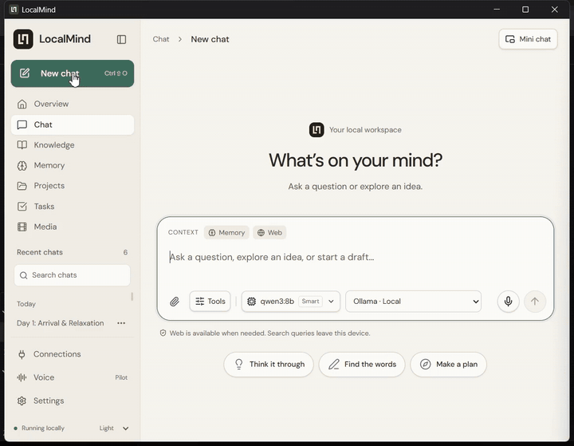
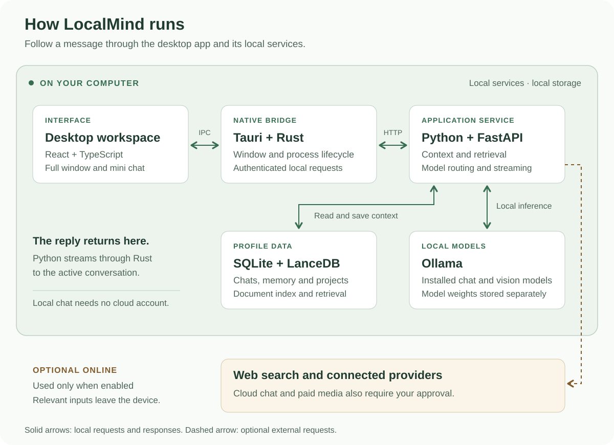

<p align="center">
  
</p>

<h1 align="center">LocalMind</h1>

<p align="center">
  <strong>Your AI workspace. On your computer. Nobody else's server.</strong><br>
  Chat with local models, ask your own documents, and keep a small chat beside your work.<br>
  No account. No subscription. No telemetry.
</p>

<p align="center">
  <a href="https://github.com/Swarneil1905/LocalMind/releases/latest"><strong>⬇ Download v1.0.0</strong></a> ·
  <a href="https://swarneil1905.github.io/LocalMind/"><strong>▶ Watch the demo</strong></a> ·
  <a href="docs/USER_GUIDE.md">User guide</a> ·
  <a href="#contribute">Contribute</a>
</p>

<p align="center">
  <a href="https://github.com/Swarneil1905/LocalMind/releases/latest"></a>
  <a href="https://github.com/Swarneil1905/LocalMind/releases"></a>
  <a href="https://github.com/Swarneil1905/LocalMind/stargazers"></a>
  <a href="LICENSE"></a>
  <a href="https://github.com/Swarneil1905/LocalMind/issues?q=is%3Aissue%20is%3Aopen%20label%3A%22good%20first%20issue%22"></a>
  <a href="https://hub.xerj.org/contributors/Swarneil1905"></a>
</p>

<p align="center">
  <a href="https://swarneil1905.github.io/LocalMind/">
    
  </a>
  <br>
  <sub>Real app, real local model (qwen3:8b), recorded on Windows. Waiting time is sped up. <a href="https://swarneil1905.github.io/LocalMind/">Watch the full video with captions ↗</a></sub>
</p>

## Why LocalMind

Most AI apps ask you to send your thinking to someone else's computer. LocalMind keeps the whole loop on yours: the model, the chat history, the memory and the search over your files.

| | |
| --- | --- |
| **Private by default** | Local chat, memory and document search run on your device. Cloud chat starts off and uses your own API account. No analytics are sent. |
| **Nothing to assemble** | One installer. Ollama and the local AI service are bundled, so there is no Docker, Python, Node.js or Rust to install. Already run Ollama? Reuse it. |
| **Answers you can check** | Turn on Web and every claim links to a source card with its publish date. When nothing current is found, LocalMind says so instead of guessing. |
| **Memory you control** | See which saved memories shaped an answer. Review, edit or delete them. Only facts you actually stated are saved. |
| **Room to work** | Pin mini chat above your editor or notes, then expand it into the full workspace with the same conversation and draft. |
| **Open source, MIT** | Read it, fork it, fix it. First issues are labelled and a failing test is a perfectly good contribution. |

## Get started

1. **[Download the installer](https://github.com/Swarneil1905/LocalMind/releases/latest)** for your computer.
2. **Pick a model** in setup. Weights download once, then chat works offline.
3. **Ask something.** Follow up in the same chat, add a folder in Knowledge, or pop out mini chat.

| Windows | macOS | Linux |
| --- | --- | --- |
| x64 `.exe` installer | Apple Silicon or Intel `.dmg`, macOS 14+ | x64 `.deb` or `.AppImage` |

Every release includes `SHA256SUMS.txt`. See [installation and updates](docs/USER_GUIDE.md#install).

<details>
<summary><strong>Model sizes, updates and installation notes</strong></summary>

| Default model | Use | Approximate download |
| --- | --- | --- |
| `qwen2.5:1.5b` | Speed preset and lightweight background work | 1 GB |
| `qwen3:8b` | Balanced preset | 5.2 GB |
| `nomic-embed-text` | Semantic document search | 274 MB |

Smaller models use fewer resources but can miss instructions and corrections. Download size is not runtime memory use; speed depends on your model, settings and hardware. LocalMind keeps the model loaded for 30 minutes after your last message, so the first message after a break is the slow one.

Updater bundles are signed with LocalMind's update key. Windows Authenticode signing and Apple notarization are not configured, so your OS may show a security prompt. Source changes do not update an installed copy until you install a newer build.

See [model setup](docs/USER_GUIDE.md#get-started).

</details>

## What you can do

| When you want to… | Use LocalMind to… |
| --- | --- |
| Think through a question | Stream a local model's answer with formatted code, tables, equations, charts and diagrams. Stop, retry or switch model presets. Answers adapt their shape to the question: steps for how-to, short bullets for news. |
| Keep working beside a chat | Pin and resize mini chat, then return to the full workspace with the same conversation and draft. |
| Understand your files | Search a project's documents and inspect cited passages with page or line locations. Missing the embedding model? One click downloads it. |
| Keep useful context | Review and remove saved memories, scoped to their project or originating chat. A nightly tidy merges duplicates after backing up first. |
| Look something up | Enable Web and inspect source links and publication dates. Queries leave your device. If Web is off, one button turns it on and retries. |
| Switch engines | Bring your own OpenAI, Anthropic, Gemini or DeepSeek key for a hard question. If a cloud answer fails, retry the same question on your local model in one click. |
| Organize a piece of work | Group chats into projects and review suggested tasks before creating them. Chats name themselves. |

Light, dark and system themes, visible keyboard focus and reduced-motion support are part of the interface. See [everyday controls](docs/USER_GUIDE.md#everyday-controls) for shortcuts.

## Honest limits

LocalMind makes a small model more useful. It does not make it a large one.

- **Answer quality depends on your model.** An 8B model can still state a wrong fact confidently. Turn on Web and check the sources for anything that matters.
- **The first message after idle is slow** while the model loads into memory.
- **Voice, media generation and connected apps are pilots.** See [optional and experimental features](#optional-and-experimental-features).
- **Profile databases are not encrypted by LocalMind.** They rely on your OS account permissions.

Passing tests does not establish answer quality, and LocalMind publishes its [conversation evaluation](evaluation/README.md) method so you can judge for yourself. Evaluation conversations **do not train any model**.

## Your data

Local chat, memory and document retrieval run on your device. LocalMind does not send product analytics. Web search sends queries to a search provider; optional cloud chat and media send approved inputs to the selected provider. Cloud chat starts disabled and uses your own API account.

Credentials use the native OS credential store with no plaintext fallback. Fetching a web page re-checks the address after connecting, so a hostile redirect cannot reach services on your machine. Release builds apply a content security policy. People sharing an OS account share its default profile. Model downloads and update checks contact their respective hosts.

Read [data destinations and storage paths](docs/USER_GUIDE.md#your-data), [cloud chat setup](docs/cloud-chat.md) and the [security policy](SECURITY.md).

## Contribute

**You do not need to understand the whole app to make a useful change.** A clearer error message, a keyboard fix or a regression test is a good place to start.

**[Find a good first issue](https://github.com/Swarneil1905/LocalMind/issues?q=is%3Aissue%20is%3Aopen%20label%3A%22good%20first%20issue%22)** · **[Browse help wanted](https://github.com/Swarneil1905/LocalMind/issues?q=is%3Aissue%20is%3Aopen%20label%3A%22help%20wanted%22)** · **[Contributor guide](CONTRIBUTING.md)**

| Your interest | Where to start |
| --- | --- |
| Interface and accessibility | Chat controls, previews and visual editors in [`apps/desktop/src`](apps/desktop/src). Frontend unit tests need no downloaded model. |
| Python and AI behavior | Context selection, retrieval and persistence in [`services/ai`](services/ai). Start with a small reproducible conversation. |
| Rust and desktop systems | Window behavior and process recovery in [`apps/desktop/src-tauri`](apps/desktop/src-tauri), or packaging in [`scripts/release`](scripts/release). |
| Writing and usability testing | Improve a setup step or try the [tester checklist](docs/product/tester-checklist.md). Documentation changes do not require installing the app. |

Check the issue discussion and [open PRs](https://github.com/Swarneil1905/LocalMind/pulls), then leave a comment with your approach. Keep your first PR focused on one observable improvement.

AI-assisted contributions are welcome. [Disclose tools and scope](docs/AI_CONTRIBUTIONS.md), read your final diff and report what you actually tested. Use the [PR template](.github/pull_request_template.md) and [review guide](docs/REVIEWING.md).

**If LocalMind is useful to you, a ⭐ helps other people find it.**

## Development

The app uses **React + TypeScript**, **Tauri + Rust**, **Python + FastAPI**, **SQLite + LanceDB**, and **Ollama**. Each installation runs its own local service and profile. There is no hosted team backend or automatic device sync.

<picture>
  <source media="(prefers-color-scheme: dark)" srcset="docs/media/architecture-dark.svg">
  
</picture>

[View light diagram](docs/media/architecture-light.svg) · [View dark diagram](docs/media/architecture-dark.svg) · [Diagram source and editing notes](docs/media/architecture.md)

**[Follow a chat message through the codebase →](docs/CODEBASE.md#follow-one-chat-message)**

For frontend-only work, with **Node.js 22 and pnpm 11.0.9** installed:

```sh
git clone https://github.com/Swarneil1905/LocalMind.git
cd LocalMind
pnpm install --frozen-lockfile
pnpm --filter desktop test
```

To submit changes, [fork the repository first](CONTRIBUTING.md#set-up-your-fork). To run the full app, follow [desktop setup](apps/desktop/README.md): Python 3.11, Rust stable, [Tauri's native prerequisites](https://v2.tauri.app/start/prerequisites/), system Ollama and the development sidecar step are also required. Use a [separate development profile](CONTRIBUTING.md#use-a-development-profile).

[](https://github.com/Swarneil1905/LocalMind/actions/workflows/ci-frontend.yml)
[](https://github.com/Swarneil1905/LocalMind/actions/workflows/ci-python.yml)
[](https://github.com/Swarneil1905/LocalMind/actions/workflows/ci-rust.yml)
[](https://github.com/Swarneil1905/LocalMind/actions/workflows/release.yml)

Releases repeat CI checks, build on native Windows/macOS/Linux runners, test installer contents and verify updater signatures. See [release engineering](docs/RELEASING.md).

## Optional and experimental features

These features have narrower support than core local chat. Check their guides before relying on them.

| Feature | Status and limits |
| --- | --- |
| Attachments and cloud chat | Screenshot/document input and optional OpenAI, Anthropic, Gemini and DeepSeek APIs. Vision needs a compatible model. Native clipboard and live provider coverage are incomplete. [Guide](docs/cloud-chat.md). |
| Visual workspace | Editable diagrams, revisions, charts and bounded learning widgets. Arbitrary generated applications remain disabled. [Guide](docs/visual-workspace.md). |
| Voice | Windows x64 English pilot, disabled by default pending microphone/playback checks. Mac/Linux voice is not implemented. [Guide](docs/voice.md). |
| Images and video | Local images disabled after quality review. Optional paid image APIs and Runway require approval; live provider acceptance remains pending. [Guide](docs/media.md). |
| Connections, MCP and plugins | Gmail read-only pilot, an owned MCP test server and built-in tools. No arbitrary third-party code or automatic chat tool execution. WhatsApp and iMessage are unavailable. [Guide](docs/connections.md). |
| Dependency repair | Track dependencies and review repair previews. File apply/restore is a Windows pilot with recovery receipts. [Code and tests](docs/CODEBASE.md). |

See the [full feature notes](docs/USER_GUIDE.md#optional-and-experimental-features) for downloads, cost limits and verification gaps, and the [v1.0.0 release notes](docs/releases/v1.0.0.md) for what changed and the known limits.

## Troubleshooting

The [user guide](docs/USER_GUIDE.md#troubleshooting) covers startup failures, slow models, Knowledge indexing and Windows installer file locks.

**[Report a bug](https://github.com/Swarneil1905/LocalMind/issues/new/choose)** with the app version, OS, model, reproduction steps and relevant errors. For a bad answer, include the smallest conversation that reproduces it. Remove private content and credentials; report vulnerabilities through [SECURITY.md](SECURITY.md).

## People and license

LocalMind's [chat diagnostics and model readiness work](https://github.com/Swarneil1905/LocalMind/commit/ed800461e34287d3d043daf43706b538ab28e23b) was selected for the **[XERJ Corpus Hub](https://hub.xerj.org/contributors/Swarneil1905)**. Its [reference corpus](https://hub.xerj.org/corpus/swarneil1905--localmind) indexes the repository at that pinned commit, with attribution to Swarneil Pradhan and LocalMind.

Thanks to everyone who reports a bug, tests a build, improves the docs or contributes code. See the [contributors](https://github.com/Swarneil1905/LocalMind/graphs/contributors) and [merged PRs](https://github.com/Swarneil1905/LocalMind/pulls?q=is%3Apr%20is%3Amerged) for the people and changes behind LocalMind.

LocalMind is [MIT licensed](LICENSE). Dependencies and downloaded models retain their own licenses.

<p align="center">
  <a href="https://star-history.com/#Swarneil1905/LocalMind&Date">
    
  </a>
</p>
