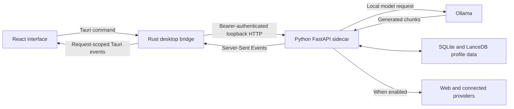

# Finding your way around LocalMind

LocalMind runs as a desktop application on each user's computer. React renders the interface, Rust manages the desktop window and local processes, Python handles application services, and Ollama runs local language models. Optional cloud chat and image API requests, off by default, use the user's own provider account. There is no shared hosted backend or team account system.

For setup and contribution steps, start with [CONTRIBUTING.md](../CONTRIBUTING.md). This guide explains where behavior lives and which files to read when changing it.

## Read these first

1. [README](../README.md): what users can do and which features are experimental.
2. [Desktop setup](../apps/desktop/README.md): dependencies, development profile and launch commands.
3. [App.tsx](../apps/desktop/src/App.tsx): how pages, settings and conversation hooks are connected.
4. [useChat.ts](../apps/desktop/src/hooks/useChat.ts): how a turn starts, streams, stops and finishes.
5. [Native commands](../apps/desktop/src-tauri/src/lib.rs): the bridge between the interface and local service.
6. [Chat route](../services/ai/app/api/routes/chat.py): context collection, answer policy, the Ollama request and dispatch to an optional cloud provider.

You do not need to read these files end to end before fixing a small bug. Follow the path for the behavior you are changing, then read its tests.

## The running system

The Python service is called the **sidecar** because the desktop app starts and manages it as a child process. The interface calls Rust through Tauri commands. Rust sends authenticated HTTP requests to the sidecar on loopback; the interface does not hold the sidecar token.

Rust launches the service on a selected local port with a fresh bearer token. Python acquires a profile lock during startup. Source development can run the Python files directly; packaged releases include a frozen sidecar executable. See [desktop runtime](DESKTOP_RUNTIME.md) for startup, storage and shutdown details.

## Follow one chat message

| Step | What happens | Read here |
| --- | --- | --- |
| 1. Compose | The user writes a message and selects a model preset and context tools. | [Composer.tsx](../apps/desktop/src/components/Composer.tsx), [App.tsx](../apps/desktop/src/App.tsx) |
| 2. Start a turn | The hook captures the conversation, history and options, installs event listeners, and invokes `chat_stream`. | [useChat.ts](../apps/desktop/src/hooks/useChat.ts) |
| 3. Forward | Rust handles `chat_stream`, tracks cancellation and calls `POST /chat/stream` on the authenticated sidecar. | [lib.rs](../apps/desktop/src-tauri/src/lib.rs) |
| 4. Assemble context | Python resolves project scope, collects enabled references, plans any web search and packs the available context. | [chat.py](../services/ai/app/api/routes/chat.py), [context_retrieval.py](../services/ai/app/context_retrieval.py), [context_budget.py](../services/ai/app/context_budget.py) |
| 5. Generate | Python applies the answer policy and model profile, uses the inference queue, and streams the Ollama response. | [chat_policy.py](../services/ai/app/chat_policy.py), [model_profiles.py](../services/ai/app/model_profiles.py), [inference_queue.py](../services/ai/app/inference_queue.py) |
| 6. Render | Rust forwards stream events with a request ID. The hook ignores events for other turns and updates the answer. | [useChat.ts](../apps/desktop/src/hooks/useChat.ts), [MessageList.tsx](../apps/desktop/src/components/MessageList.tsx), [AnswerContent.tsx](../apps/desktop/src/components/AnswerContent.tsx) |
| 7. Save | On successful completion, `App.tsx` calls the conversation hook to save the turn and sources through Rust to Python. Follow-up suggestions and enabled memory extraction are separate work. | [useConversations.ts](../apps/desktop/src/hooks/useConversations.ts), [conversation routes](../services/ai/app/api/routes/conversations.py), [memory routes](../services/ai/app/api/routes/memory.py) |

Stopping a turn, switching chats and retrying a failed request are different operations. Preserve their request IDs and captured conversation scope when changing this flow. [Chat reliability](CHAT_RELIABILITY.md) explains the failure cases and existing protections.

## Repository map

| Location | Responsibility |
| --- | --- |
| [apps/desktop/src](../apps/desktop/src) | React pages, components, hooks, styles and frontend tests. `main.tsx` mounts the app; `App.tsx` connects its state and views. |
| [apps/desktop/src-tauri](../apps/desktop/src-tauri) | Tauri configuration, capabilities, native command handlers and window behavior. `src/lib.rs` is the command entry point. |
| [crates/localmind-core](../crates/localmind-core) | Sidecar startup, local HTTP/Ollama clients and owned child-process handling. |
| [crates/localmind-db](../crates/localmind-db) | Rust SQLite pool and migration utilities. Current conversation and memory routes use Python persistence; this crate is not their database owner. |
| [crates/localmind-permissions](../crates/localmind-permissions) | Placeholder crate with a sample function and test. It does not enforce the app's permissions. |
| [services/ai/main.py](../services/ai/main.py) | Service process entry point; reads launch configuration and starts the loopback server. |
| [services/ai/app/main.py](../services/ai/app/main.py) | FastAPI setup, authentication middleware, routes, startup recovery and shutdown cleanup. |
| [services/ai/app/api/routes](../services/ai/app/api/routes) | HTTP endpoints for chat, models, conversations, memory, Knowledge, projects and optional features. |
| [services/ai/app/db](../services/ai/app/db) | Persistence for conversations, memories, Knowledge, projects, messages, people and search settings. |
| [services/ai/tests](../services/ai/tests) | Python service tests, including scope, recovery, model readiness and action boundaries. |
| [evaluation](../evaluation), [scripts/evaluation](../scripts/evaluation) | Synthetic conversation cases, dataset instructions, replay tools and evaluation checks. These do not train model weights. |
| [scripts/media](../scripts/media) | Optional image worker and media research tooling, separate from the normal desktop service dependencies. |
| [scripts/release](../scripts/release) | Sidecar/runtime packaging, installer checks, signing verification and publishing tooling. |
| [.github/workflows](../.github/workflows) | Frontend, Python, Rust, release and walkthrough automation. |
| [scripts/contributing](../scripts/contributing), [.github/pull_request_template.md](../.github/pull_request_template.md) | PR declaration checks and their tests. The check reads event metadata and does not perform an AI code review. |
| [.github/skills/team-review](../.github/skills/team-review), [review guide](REVIEWING.md) | Review perspectives, evidence requirements and human merge responsibility. [Maintainer setup](MAINTAINER_SETUP.md) covers optional Copilot activation. |
| [docs/watch](watch) | Browser video player for the README walkthrough. |

## Where to make a change

Paths in this table are relative to the repository root. The layer that displays a feature is often different from the layer that owns its data or decisions.

| Area | Start with | Tests and background |
| --- | --- | --- |
| Chat layout, Markdown and composer | `apps/desktop/src/components/Composer.tsx`, `MessageList.tsx`, `AnswerContent.tsx`; shared styles in `App.css`, `workspace-design.css`, `calm-surfaces.css` | [Frontend tests](../apps/desktop/src/__tests__), [chat interface guide](chat-interface.md) |
| Streaming, stop and retry | `apps/desktop/src/hooks/useChat.ts`, native `chat_stream` and `cancel_chat` commands, `services/ai/app/api/routes/chat.py` | [useChat.test.tsx](../apps/desktop/src/__tests__/useChat.test.tsx), [test_chat_reliability.py](../services/ai/tests/test_chat_reliability.py) |
| Model setup and generation settings | `services/ai/app/model_readiness.py`, `model_profiles.py`, `api/routes/models.py`; frontend model hooks and settings components | [test_model_readiness.py](../services/ai/tests/test_model_readiness.py), [test_model_profiles.py](../services/ai/tests/test_model_profiles.py), [evaluation guide](../evaluation/README.md) |
| Answer policy and context selection | `services/ai/app/chat_policy.py`, `context_retrieval.py`, `context_budget.py` | [test_chat_policy.py](../services/ai/tests/test_chat_policy.py), [test_context_retrieval.py](../services/ai/tests/test_context_retrieval.py), [test_context_budget.py](../services/ai/tests/test_context_budget.py) |
| Memories and links | `services/ai/app/api/routes/memory.py`, `db/memories.py` | [test_memory_scope.py](../services/ai/tests/test_memory_scope.py), [test_memory_link_indices.py](../services/ai/tests/test_memory_link_indices.py) |
| Documents and citations | `services/ai/app/api/routes/knowledge.py`, `db/knowledge.py`, `knowledge_documents.py` | [test_knowledge_indexing.py](../services/ai/tests/test_knowledge_indexing.py) |
| Web search and source evidence | `services/ai/app/search/planning.py`, `providers.py`, `fetcher.py`; orchestration in `api/routes/chat.py` | [test_search_planning.py](../services/ai/tests/test_search_planning.py), [chat reliability](CHAT_RELIABILITY.md) |
| Project tasks and file repairs | `services/ai/app/task_actions.py`, `action_boundary.py`, `project_graph.py`, `project_repairs.py`, `repair_apply.py` | [test_task_actions.py](../services/ai/tests/test_task_actions.py), [test_repair_apply.py](../services/ai/tests/test_repair_apply.py) |
| Startup, shutdown and console windows | `crates/localmind-core/src/sidecar.rs`, `process.rs`, `process/owned.rs`; native command state | Rust tests alongside implementation; [test_desktop_runtime.py](../services/ai/tests/test_desktop_runtime.py), [runtime guide](DESKTOP_RUNTIME.md) |
| Mini chat | `apps/desktop/src/hooks/useMiniWindow.ts`, `apps/desktop/src-tauri/src/mini_window.rs` | [Frontend tests](../apps/desktop/src/__tests__), [chat interface guide](chat-interface.md) |
| Cloud chat providers, approval and cost ledger | `services/ai/app/providers.py`, `provider_store.py`, `credentials.py`, `api/routes/providers.py`; preview and dispatch in `api/routes/chat.py` | [test_providers.py](../services/ai/tests/test_providers.py), [test_multimodal_chat.py](../services/ai/tests/test_multimodal_chat.py), [test_provider_live.py](../services/ai/tests/test_provider_live.py) (opt-in, paid), [cloud chat guide](cloud-chat.md) |
| Connections, MCP and extensions | `services/ai/app/connectors`, `credentials.py`, `mcp_client.py`, `mcp_server.py`, `plugins.py`, `recipes.py` | [test_connections.py](../services/ai/tests/test_connections.py), [test_mcp.py](../services/ai/tests/test_mcp.py), [connections guide](connections.md) |
| Voice | `services/ai/app/voice.py`, `api/routes/voice.py`; frontend voice hook and controls | [test_voice.py](../services/ai/tests/test_voice.py), [voice guide](voice.md) |
| Images and video | `services/ai/app/media.py`, `media_store.py`, `media_files.py`, `cloud_images.py`, `api/routes/media.py`; `scripts/media` | [test_media.py](../services/ai/tests/test_media.py), [test_cloud_images.py](../services/ai/tests/test_cloud_images.py), [media guide](media.md) |

## Data and permission boundaries

[storage.py](../services/ai/app/storage.py) chooses the profile directory and manages its lock. The Python database modules own the current chat, memory and Knowledge persistence. Different features use different stores; do not assume all data lives in one database. Some frontend preferences, such as theme, also live in WebView local storage.

Project and conversation IDs determine which context a turn may use. Keep scope checks in the service even when the UI filters what it shows. A regression test for a scope change should include data from another project or conversation and verify it stays excluded.

The sidecar token authenticates desktop-to-service requests. It is not a multi-user account system. [credentials.py](../services/ai/app/credentials.py) stores Gmail, Runway and cloud chat API keys (OpenAI, Anthropic and Google Gemini) in the native credential store, scoped by the profile path, and accepts only keys on its allow-list. [providers.py](../services/ai/app/providers.py) reads the chat keys, and [cloud_images.py](../services/ai/app/cloud_images.py) reuses the stored OpenAI key for image API requests. [provider_store.py](../services/ai/app/provider_store.py) keeps the local-only policy, the standing approvals per provider, model and data categories, and the estimated-cost ledger in the profile, never the keys. Ordinary profile databases are not encrypted by LocalMind. Ollama model storage is separate from the profile.

Review requirements for actions live in service code such as [action_boundary.py](../services/ai/app/action_boundary.py), [task_actions.py](../services/ai/app/task_actions.py) and [repair_apply.py](../services/ai/app/repair_apply.py), alongside native capability restrictions. Preserve confirmation, scope validation and recovery behavior when changing an action. The placeholder permissions crate is not a substitute for those checks.

Web pages, retrieved documents and model outputs are untrusted input. Keep reference content separate from application instructions. Web search, connected providers and paid media requests have different data destinations and consent requirements; follow the relevant feature guide and [security policy](../SECURITY.md).

## Debug a weak answer before changing the model

First capture the model tag, settings, context toggles and the smallest conversation that reproduces the problem. Then locate the failure:

| Observation | Investigate |
| --- | --- |
| A reply appears under the wrong turn, or keeps arriving after Stop | Request IDs, cancellation and event handling in `useChat.ts` and the Rust bridge. |
| The reply ignores the current question or uses unrelated facts | Sent history, conversation/project scope, retrieved references and context packing. |
| A recent-news answer contains stale or unsupported claims | Search planning, publication dates, fetched evidence and citation handling. |
| Correct content displays as raw Markdown or broken math | `AnswerContent.tsx` and rendering tests. |
| Context is correct but the answer still misses instructions | Answer policy, model profile and controlled comparisons with another installed model. |

Use the [evaluation tools](../evaluation/README.md) to compare behavior. Unit tests establish application contracts; they do not prove that a model gives useful answers. A model comparison should preserve the prompt and settings, record hardware and latency, and include human review of the responses.

## What is still experimental

Code presence does not mean a feature has passed live acceptance. Voice is a Windows pilot, local images remain disabled after quality review, and Gmail and Runway still need live acceptance checks. Cloud chat and image API tests use mocked provider responses: the paid chat smoke test in `test_provider_live.py` runs only on explicit opt-in, and live paid-image acceptance is still pending. The automated native credential-store check runs only on Windows. MCP and plugins currently cover owned or built-in tools rather than arbitrary third-party execution. WhatsApp and iMessage are unavailable.

Check the [README feature status](../README.md#optional-and-experimental-features) and the relevant feature guide before changing defaults or describing a feature as available. For a first PR, choose one observable behavior, trace its owner and add the test that would have caught the problem.
