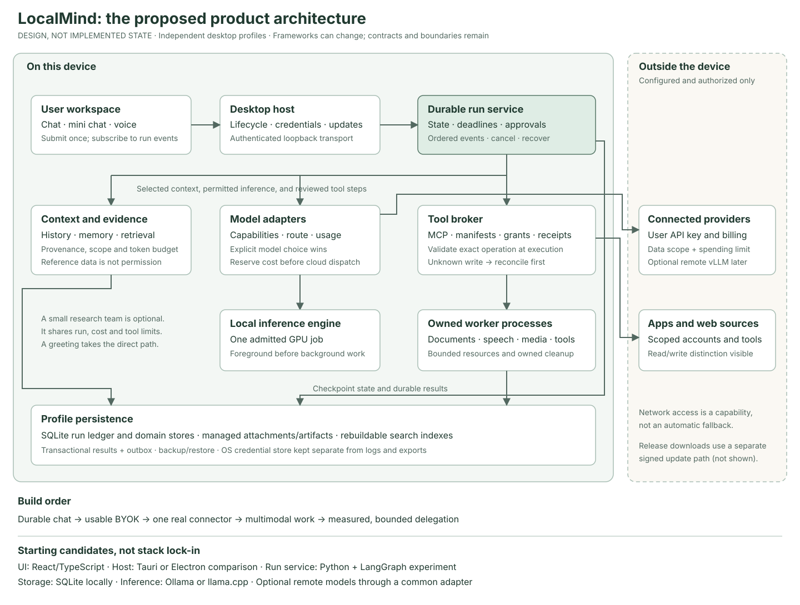

# LocalMind system design

**Status: proposed architecture, not implemented functionality.** Research date: 14 November 2026. Local source reviewed at `4b5f30c4443f3ec8949a326151f3a67968588515`. This design preserves independent desktop installations and optional user-funded cloud APIs. It does not introduce a hosted multi-tenant service.

## Product decision

For the selected MVP stack, model roles, database alternatives and document-workflow release gates, see [MVP architecture](architecture/MVP_ARCHITECTURE.md). It narrows this broader proposal and records which retrieval features already exist in the current code.

Build a personal AI workspace that can explain, research, work with screenshots and documents, and carry out reviewed tasks. A person should be able to see which model answered, what information it used, what left the device, and whether an action actually finished.

The immediate product promise is narrower than matching every ChatGPT or Claude feature: dependable conversations and useful work across a person's own material, with local execution by default and explicit access to stronger models. A good model is necessary for difficult reasoning. Reliable context, tool results, persistence, and presentation are necessary even with that model.

Treat React/TypeScript, Tauri/Rust, Python/FastAPI, SQLite, and Ollama as starting candidates, not fixed requirements. The user has explicitly authorized a stack pivot if it improves product viability. Choose implementations against the contracts below; preserve those contracts when replacing a framework. A swarm, an inference server, and a collection of skills solve different problems; none substitutes for these boundaries.

## Technology choices remain replaceable

The diagram describes responsibilities and trust boundaries independently of language. This proposal still assumes independent desktop installations; permission to change the stack does not imply a switch to a hosted subscription service.

| Boundary | Starting candidate | Alternative worth testing | Evidence that would justify a pivot |
|---|---|---|---|
| User workspace | React/TypeScript | Another UI framework only for a demonstrated requirement | Better task completion, accessibility or maintenance on the same chat/artifact flow; visual style alone is not a framework constraint |
| Desktop host | Tauri/Rust | Electron with a narrow preload bridge and isolated workers | A packaged comparison of clipboard, voice, mini chat, updates and crash recovery removes persistent platform failures at acceptable memory, installer-size and maintenance cost |
| Run coordination | Python service with explicit run contracts | LangGraph executor behind those contracts; a TypeScript coordinator if it removes proven integration burden | Fewer bespoke recovery paths while preserving replay, migrations, approval integrity, cancellation and local packaging |
| Local inference | Ollama adapter | Direct llama.cpp integration | Same weights, quantization and context show a material startup, memory or packaging benefit after lifecycle costs are counted |
| Remote inference | Existing approved cloud adapters | User-operated vLLM endpoint | A real server workload benefits from throughput/concurrency; this does not replace every user's desktop runtime |
| Profile persistence | SQLite and managed files | PostgreSQL plus object storage for a separately designed hosted service | Actual shared tenancy, concurrent writers or hosted durability requirements; no premature migration of desktop profiles |
| Parsing, speech and media | Owned worker processes | Rust/C++ worker for a measured hot path; a provider adapter for optional remote work | Profiling or native reliability tests identify a bottleneck that changes user-visible performance |

Tauri uses a Rust core with webview rendering; Electron uses a Chromium-derived main/renderer process model. Both still need a carefully restricted privileged interface. A switch cannot be assumed to improve reliability or reduce memory without testing the packaged application. [Tauri architecture](https://v2.tauri.app/concept/architecture/), [Electron process model](https://www.electronjs.org/docs/latest/tutorial/process-model).

The first substantial architectural change should be durable orchestration. LangGraph is a candidate because its checkpointing and stores separate per-run state from longer-lived information. Test it with LocalMind's recovery and side-effect contracts before selecting it. Keep the app-owned run/event format independent of framework checkpoint internals, so future replacement does not require rewriting the UI or abandoning saved history. [LangGraph persistence](https://docs.langchain.com/oss/python/langgraph/persistence).

For any replacement, build one vertical slice against the same fixtures, compare packaged behavior and resource use, migrate an isolated copy of a profile, and retain a rollback path. Do not run two competing production coordinators against the same profile. A Go, Java or C# rewrite remains possible, but needs a concrete operational or team advantage rather than a language preference.

## Evidence and scope

- [Product comparisons and inspected source paths](research/product-patterns-2026-11.md): Life, Jan, LibreChat, Open WebUI, and documented commercial workflows.
- [All requested development tools](research/developer-tools-2026-11.md): purpose, Codex compatibility, and adoption decision.
- [Inference, agents, billing, voice, and evaluation research](research/runtime-decisions-2026-11.md).
- [Implementation sequence and acceptance criteria](architecture/IMPLEMENTATION_PLAN.md).
- [Existing codebase guide](CODEBASE.md) describes the implementation today. This document describes its proposed evolution.

REA's [current source-analysis guidance](https://github.com/morluto/rea/blob/01192ab73712478f90c7407db5d459198bebba44/.agents/skills/reverse-engineer-anything/SKILL.md) directs ordinary repository analysis to source tools. Accordingly, this study inspected source and documentation; it did not decompile products or claim to observe their runtime behavior. No third-party code was installed or executed for this study. Repository popularity helped select references; it is not a reliability measurement.

## What exists and what is missing

| Area | Source observation | Proposed change |
|---|---|---|
| Desktop ownership | Rust owns the sidecar; Python `storage.py` locks a profile | Keep ownership. Expose one startup/recovery state to all windows and the updater |
| Chat | `api/routes/chat.py` gathers evidence, prepares prompts, dispatches, and streams | Extract a run coordinator with versioned events; leave HTTP as transport |
| Persistence | `useChat.ts` invokes a completion callback and handles save failures | Persist accepted requests and run state in the service before work starts; UI becomes a subscriber |
| Inference | `inference_queue.py` serializes local inference with foreground priority | Keep GPU admission control; add persistent job scheduling separately |
| Cloud | `providers.py`, `provider_store.py`, and `credentials.py` implement adapters, native secrets, consent, reservations, and uncertain charges | Extend these foundations with capability contracts and explicit routing; do not create a second billing system |
| Context | `context_budget.py` protects the current request, recent history, and bounded references using a conservative byte estimate | Add source identities, model-aware accounting, summaries with provenance, and diagnostic comparisons |
| Actions | `task_actions.py` persists a reviewed task proposal and returns an idempotent receipt | Generalize the action envelope while retaining each connector's authorization and validation |
| MCP | `mcp_client.py` accepts exactly the owned fixture server and its known tools | Build a separately gated general MCP client; the fixture is not a marketplace |
| Recipes | `recipes.py` accepts exactly one synthetic repair package | Introduce versioned, permission-scoped workflows only after executor contracts exist |
| Quality | CI already runs backend unit/database/integration tests, platform persistence, frontend/Rust checks, and release tests | Add missing behavioral and failure-path coverage; test quantity alone is not the goal |

The current chat hook passes `connectorContextEnabled: false`. The presence of a backend connector does not prove the normal chat path uses it. The current answer policy also explicitly describes a chat without action-execution tools. Both must change through tested capability plumbing, not by telling the model it can do more.

## User journeys that define the architecture

1. **Explain and follow up.** Ask about a concept, request an example, then a diagram. Each turn follows the active conversation, across arbitrary topics. Memory cannot substitute a different subject. No search or agent team is needed for a greeting.
2. **Research something current.** Ask a dated question. Show search activity, relevant dated evidence, the answer, and source links. Distinguish provider failure, no matches, inaccessible pages, undated evidence, and stale results. A supported data API can answer weather from observation timestamps; a generic publication-date filter cannot do that alone.
3. **Work from a screenshot.** Paste an image, preview it, select a compatible model, approve any cloud transfer, ask a follow-up, and produce an editable artifact. Preserve attachment ownership when switching chats or opening mini chat.
4. **Prepare and perform a task.** Read connected information, propose an exact change, show destination and consequences, obtain approval where required, execute once, and display a receipt. A timeout must not turn into a second email or duplicate task.
5. **Continue later.** Close or restart the app during research. Reopen the same run with its partial answer and status. Resume safe work; ask the user to resolve an ambiguous external action instead of replaying it.

## System boundaries



The diagram is a proposed control/data flow. The text below is its accessible, diff-friendly companion.

```text
LOCAL DEVICE / OS USER PROFILE

 Full chat, mini chat, voice, artifact workspace       [React]
                      |
         typed commands + versioned run events
                      |
 Desktop host: credentials, lifecycle, update, windows [Tauri / Rust]
                      |
       authenticated loopback transport, no public bind
                      |
 Run service + policy + context + model routing       [Python]
       |              |                  |
       |              |                  +--> Model adapters
       |              |                         | local Ollama
       |              |                         | optional remote vLLM
       |              |                         | approved cloud API
       |              |
       |              +--> Tool broker --> owned worker processes
       |                                    | MCP / connector
       |                                    | document / voice / media
       |
       +--> SQLite run ledger + existing domain stores
       +--> attachment/artifact files + rebuildable search indexes

NETWORK BOUNDARY: every provider/tool destination has a data scope,
credential scope, timeout, request budget, and visible connection state.
UPDATE BOUNDARY: signed release assets and manifests; independent of AI health.
```

These are logical modules, not twelve separately deployed services. One sidecar hosts orchestration, retrieval, persistence, and adapters. Separate processes are justified for crash-prone document parsers, media jobs, and external tools. A child process alone is not an OS security sandbox.

### Module contracts and ownership

| Module | Owns | Must not do |
|---|---|---|
| Desktop host | One installed instance per profile, child lifecycle, secret access, updater | Interpret generated code as privileged commands |
| Run coordinator | State transitions, deadlines, event ordering, cancellation, checkpoints | Invent a completion receipt or silently retry a write |
| Context service | Canonical history, retrieval scopes, source provenance, token allocation | Grant permissions from retrieved text |
| Model router | Eligible models, explicit selection, measured route policy | Upload to cloud because the local model is slow without consent |
| Provider adapters | Provider protocol, normalized streaming, usage, error classes | Set global budgets or maintain conflicting conversation state |
| Tool broker | Manifest validation, grants, schema validation, execution receipts | Treat MCP descriptions as trusted authorization |
| Worker supervisor | Start/stop owned children, resource limits, cleanup | Kill unrelated Ollama or other applications by process name |
| Storage repositories | Transactions, migrations, scoped queries, backup | Treat vector search as the authoritative conversation store |
| Artifact service | Validated data, revisions, provenance, export | Run arbitrary model-generated HTML with host privileges |

## Durable run lifecycle

Use a service-owned `Run` for every user request. A simple reply takes the short path; it does not need a plan, multiple agents, or a critique call.

`accepted → preparing → queued → running → completed`

Additional states: `waiting_for_approval`, `cancelling`, `cancelled`, `interrupted`, `failed`, and `needs_reconciliation`. Transitions are checked by the service. An external action with an unknown outcome enters `needs_reconciliation`; it is neither success nor a safely retryable failure.

Proposed contract fields:

- Run: `id`, `conversation_id`, `project_id`, `request_message_id`, `parent_run_id`, `state`, `revision`, `deadline_at`, `policy_version`, `capability_snapshot`, `route`, `created_at`.
- Step: `id`, `run_id`, `kind`, `state`, `attempt`, `input_ref`, `output_ref`, `lease_owner`, `lease_until`, `idempotency_key`.
- Event: `run_id`, monotonic `sequence`, `schema_version`, `type`, `payload`, `created_at`. Payload types cover status, text batches, evidence, artifact references, approvals, usage, and completion.
- Approval: exact operation/arguments hash, destination, selected data scope, credential reference, expiry, decision, and reviewed manifest version.
- Receipt: operation identity, external object ID where available, observed result, verification time, and reconciliation status.

Add a versioned `runs.db` first. Keep existing domain databases behind repository interfaces. Do not attempt a destructive all-database migration alongside the runtime change. Transactions across separate files require explicit handling: an outbox and idempotent domain handler reconcile a completed result into the existing conversation store. Mark completion only after the durable result is stored. On a duplicate request ID, return the existing run if its immutable payload matches; reject mismatches.

Persist text in small batches, not a synchronous transaction per token. UI replay reads after its last acknowledged event sequence, deduplicates events, and receives a snapshot if older events were compacted. Bound replay storage and apply backpressure to slow subscribers. Keep message IDs distinct from attempt IDs so retries cannot silently duplicate turns.

SQLite stores the job lifecycle. The existing in-memory inference queue grants a local compute slot only while a model request is active. Never hold that slot while awaiting human approval or remote I/O. On restart, expired leases identify interrupted work. Restart a pure read only when its contract permits it; do not promise deterministic model replay or exactly-once external side effects.

## Model choice, BYOK, and latency

Expose three product choices: **On device**, **Connected provider**, and later **Automatic within my rules**. Explicit model choice always wins. An automatic route filters by privacy permission, modality, tools/structured-output support, availability, context capacity, deadline, and budget before it compares expected quality and speed.

Maintain a provider-neutral capability record, including verification date and evidence. An OpenAI-compatible URL does not prove support for every tool schema, image format, or streaming event. Initially support the existing provider adapters plus Ollama; place remote vLLM behind the same interface only when someone needs a self-hosted inference server. Keep provider-specific errors and usage details available in diagnostics.

BYOK setup: choose provider → open its account/billing page → create a restricted API key → store in OS credentials → choose model → validate connection/capabilities → set an app spending limit → review categories of data allowed to leave. LocalMind never sells an API token denomination. The user pays the provider under its terms. Chat subscriptions and API access are different products, although some current plans offer linked API credits; eligibility and redemption are provider-specific. Do not reuse consumer login cookies or promise subscription quotas work with arbitrary integrations.

Retain `provider_store.reserve()` and uncertain-charge handling. Reserve each attempt before dispatch, freeze the price-version used for estimates, settle reported usage, and retain a conservative reservation when usage is unknown. The local limit is not a guarantee about the provider's invoice, other clients using the key, taxes, or changed prices. Unknown pricing blocks automatic routing under a budget. Provider-side limits should be configured too.

Use direct model calls as a comparison baseline. Measure local cold loading, queue wait, context preparation, prompt evaluation, first visible answer, generation, and total time separately. Disable unnecessary thinking on simple turns through supported model parameters; do not hide 20 seconds of delay behind an animation. Schedule embedding and media jobs around active chat, and keep model downloads optional with size/hardware information. Hardware inventory was unavailable in this investigation, so no model recommendation here is a tested fit for this computer.

For conversational quality, expose a few durable preferences such as response depth, tone and teaching style. Keep the default policy short and load task-specific output instructions only when needed. Test whether answers respond to the actual question, explain with an example, and adapt to follow-ups. Warmth should come from useful, attentive replies, not invented personal experiences, compulsory emojis, or a repeated closing question. A fine-tuned style cannot repair missing evidence or an incorrect tool route.

## Context and memory

Context assembly is a policy, not concatenation of every available source:

1. System policy and current application capabilities.
2. Latest request and its attachment references.
3. Relevant recent conversation and corrections in original order.
4. A source-linked conversation summary if needed.
5. Scoped personal memory, project documents, and tool/web evidence within separate budgets.

Each evidence item carries origin, stable ID, owner scope, retrieval time, relevant source time, text range, and trust category. Documents and tool output remain data. Use exact-match/keyword retrieval plus semantic retrieval where helpful; rerank only when evaluation shows enough benefit to justify the latency. Vector results must still pass ownership and deletion checks.

Memory writes remain separate from answering. Propose facts with their source turn, allow correction/deletion, track superseded facts, and invalidate derived indexes on changes. Personal preferences can be shared across projects only through an explicit scope. Project facts cannot leak through a global nearest-neighbor query. Conversation summaries must not promote an earlier assistant claim into an observed fact.

Keep the existing conservative estimator as a fallback. Introduce model-aware token counting where available, account for images/tools, and record what was excluded. Compression must preserve source identities, exceptions, units, negations, and user corrections. A lower token count is not a successful compression test by itself.

## Tools, MCP, and approvals

Start with curated read-only connectors and explicit installations. Use the maintained MCP client SDK behind LocalMind's broker rather than expanding the fixture parser into a complete protocol implementation. Pin a protocol version and test version negotiation, transport errors, tool-list changes, OAuth lifecycle, and disconnect behavior.

Remote MCP requires validated OAuth discovery, audience-bound tokens, redirect validation, and no token passthrough. Local stdio servers need an exact executable, arguments, manifest, restricted environment, owned process tree, and declared permissions. A server can be malicious even if its transport works. See the [MCP security guidance](https://modelcontextprotocol.io/docs/2025-11-25/tutorials/security/security_best_practices).

Classify actions as read, private local write, external write, destructive operation, or paid operation. The UI explains the proposed destination and data. The backend enforces the decision independently. Revalidate scope, grant expiry, schema, and resource version immediately before execution. Changed arguments or tool manifest invalidate the old approval. Never inherit a specialist agent's permission merely because its parent was approved to research.

Use idempotency keys where supported. If a connector cannot prove whether a write succeeded, inspect the destination or request user reconciliation. Retries with backoff and jitter are suitable for bounded reads and provider-declared safe failures, not arbitrary writes. A circuit breaker distinguishes authentication failures, rate limiting, transient faults, and malformed responses.

For browser tasks, prefer a documented API. If browser control is necessary, use an isolated profile, domain constraints, visible task intent, and approval before external side effects. Playwright availability is not permission to control the user's personal browser.

## Agents and workflows

The default is one capable model with selected tools. For known tasks, use a deterministic workflow with explicit inputs and checks. For independent research, allow a bounded team only after it outperforms the single-agent baseline on LocalMind's tests.

Initial experiment: one coordinator, at most two research workers, and one optional verification pass. Give each worker a narrow evidence packet, read-only grants, a deadline, and an output schema. Set a total run budget and step limit; reject recursive delegation. A reasonable first test configuration is eight total model calls and a three-minute deadline, configurable rather than a product promise. Local GPU calls remain serialized; network reads may run concurrently. Cloud worker concurrency needs atomic budget reservations and provider limits.

Workers return findings, source references, unresolved questions, and artifact references. They do not dump entire private histories into one another's context. The coordinator checks conflicting evidence and reports uncertainty. Multiple agents repeating the same unsupported claim is not independent verification.

Prototype one LangGraph workflow behind a small executor interface and compare it with an explicit Python state machine. Evaluate checkpoint compatibility, replay semantics, approvals, packaging size, and failure recovery. The experiment must not replace the simple chat path until it meets the same contracts. A framework checkpointer does not make a third-party write idempotent.

## Voice, images, and artifacts

Voice uses microphone permission → voice activity detection → speech recognition → editable transcript → normal run service → incremental speech synthesis. Interruption stops audio playback and requests cancellation of generation/tool work; it cannot undo a write that already completed. Keyboard and transcript controls remain available. Show whether audio stays local; keep raw recordings off by default and specify retention when enabled.

Screenshot input uses the existing attachment pipeline with MIME/signature checks, decoded size limits, previews, and conversation ownership. Use a vision-capable model for visual interpretation; OCR is an explicitly labeled fallback, not equivalent vision. A text model cannot gain image understanding merely because the UI accepts a PNG.

Keep validated diagrams, charts, and bounded widgets. Add a graph editor/renderer such as React Flow only after a focused license, accessibility, and bundle review; it improves editing, not the correctness of generated diagrams. Allow step controls, node selection, revision history, source navigation, and exports. Retain Mermaid for compact text-authored diagrams. Arbitrary generated web apps need a separate sandbox design before launch; an iframe flag alone is not the whole boundary.

Image generation remains a separately evaluated capability. Show hardware requirements or provider cost, preview provenance, and support cancellation. Do not enable a failed local quality gate because the model downloaded successfully. Video generation is an asynchronous paid job with estimate, explicit approval, status polling, retained job ID, and an expiring-download recovery path.

## Persistence, security, and updates

- Keep authoritative conversations, runs, grants, receipts, and model configuration in profile-scoped SQLite stores. Use transactions, foreign keys, bounded busy timeouts, and tested migrations. Vector indexes are rebuildable; they are not backups.
- Store binary attachments/artifacts in managed directories with content IDs and ownership records. Validate paths, reject traversal, and garbage-collect only unreferenced data after a grace period.
- Keep secrets in OS credential storage. Do not serialize them in prompts, logs, backups, MCP environments, or exported support bundles. Secret isolation from another malicious process running as the same user is not guaranteed by the current app.
- Back up SQLite through its supported backup mechanism and copy a consistent referenced-file inventory. Test restoration, migrations from two prior versions, low disk space, interrupted writes, and rollback rules. A database on one laptop is not replicated durable cloud storage.
- Keep updater access independent of sidecar/model availability. Validate signed manifests/artifacts, platform/channel compatibility, and the installed build identity. Shut down owned children, release file locks, migrate after backup, and show a recovery path on failure. Never claim a code push updated an installed binary.
- For future device sync, use a separate design covering identity, encryption/key recovery, deletion propagation, conflict resolution, and consent. Do not expose the local sidecar to the public internet as a shortcut.

## Observability and release gates

One run ID joins UI events, provider attempts, retrieval, tool calls, and receipts. Local diagnostics show stage timings, selected model, dropped context counts, source outcomes, usage estimates, and cancellation state. Export redacted reports explicitly. Full prompts, images, tool output, and personal paths are excluded by default. Use OpenTelemetry-compatible concepts where useful; pin the relevant [GenAI convention version](https://opentelemetry.io/docs/specs/semconv/gen-ai/) rather than depending on a moving schema.

These are proposed acceptance targets, not measured results:

| Gate | Initial target and method |
|---|---|
| Request visibility | p95 acknowledgement under 250 ms on the declared test machine, including queued status |
| Ordinary chat | p95 first visible answer under 3 s for warmed, short prompts on a qualifying local model; record cold starts and CPU-only machines separately |
| Cancellation | p95 visible acknowledgement under 500 ms; owned generation/tool cleanup verified within 2 s where the adapter supports it |
| Recovery | 100 consecutive automated start/stop/interruption cycles without orphaned owned children or lost accepted requests |
| Isolation | All deterministic conversation/project/attachment/grant isolation cases pass |
| External writes | Fault-injection cases never silently repeat an operation with unknown outcome |
| Conversation quality | At least 90% of a frozen 100-scenario, multi-turn acceptance set passes a task-specific rubric, with zero critical privacy/action failures |
| Model recommendation | Compare at least two local candidates and one optional approved cloud baseline, recording quality, latency, memory, and cost; publish limitations |

Maintain separate deterministic CI and stochastic model evaluation. Required PR checks run offline fixtures: policy, routing, provider streaming, authorization, database migrations, event replay, cancellation, frontend interaction, Rust lifecycle, and packaging contracts. A scheduled/manual job evaluates real models on identified hardware and versions. Paid-provider tests have an explicit spend ceiling and do not expose keys to untrusted fork jobs.

Add property-based state-transition tests and fault injection at transaction/dispatch/receipt boundaries. Include 401/429/5xx, malformed and truncated streams, image capability mismatches, full disk, locked database, application crash, changed permissions, and a slow subscriber. Test real Windows/macOS/Linux behavior in native jobs. Track coverage of important branches; do not inflate tests by mirroring the implementation.

Ten thousand paraphrases are not ten thousand independent quality tests or training examples. Keep regression suites, exploratory datasets, and any future fine-tuning set separate. Fine-tuning requires licensed data, a measured failure class, train/validation/test separation, and an improvement over a prompt/retrieval/model-selection baseline. It is not the first intervention for a broken search route.

## Applying the 17 system-design concepts

| Concept | LocalMind decision now | Trigger for more infrastructure |
|---|---|---|
| Load balancing | Dispatch among explicitly permitted model endpoints; one local GPU admission queue | Multiple owned inference servers and measured concurrent demand |
| Caching | Model metadata and scoped retrieval cache with TTL/version invalidation; never cached permission decisions | Shared service with measured cache pressure |
| CDN | Existing release/demo distribution only | Hosted media delivery with significant traffic |
| API gateway | Native command boundary plus authenticated loopback API | Public service needs auth, quotas, tenant routing |
| Microservices | Defer; use modules and justified worker processes | Independent scaling/ownership outweighs deployment cost |
| Monolithic architecture | Modular sidecar with explicit contracts | Revisit only after measured limits |
| Replication | Consistent backup/restore first; not live replication | Multi-device sync or hosted availability requirement |
| Partitioning | Profile/project/conversation ownership and bounded indexes | Storage or query load exceeds a single node |
| Message queues | Durable SQLite jobs/events plus in-memory compute admission | Multiple remote workers require a broker |
| Rate limiting | Per-provider, per-tool, per-run limits and bounded queues | Add tenant quotas for any future service |
| Consistent hashing | Not needed for one profile store | A real distributed cache/shard topology |
| CAP theorem | Not a reason to complicate a single-device database | Define offline and conflict semantics before distributed sync |
| Horizontal scaling | Independent installations scale across users naturally | Shared inference/sync service is introduced |
| Vertical scaling | Adapt model/context/media load to RAM/VRAM and thermal limits | Larger machines justify larger models after testing |
| Fault tolerance | Checkpoints, leases, idempotency, backups, owned-process recovery | Add replication/failover for a hosted SLA |
| Circuit breakers | Isolate failing providers/connectors and expose recovery | Already useful at desktop scale |
| Event-driven architecture | Versioned local run events/outbox, with retention limits | Broker only when cross-machine delivery is necessary |

Instagram's media workers and separation between metadata and blobs are useful patterns. Its global fan-out, Cassandra, Kafka, social graph, and ranking infrastructure solve different workloads. Copying them would increase LocalMind's installation and operating burden without addressing the failures in the supplied chats.

## Differentiation to test

**Private context with visible provenance.** A user can inspect why a memory/file influenced a reply, correct it, and verify the next answer changes. Test whether this beats a plain chat plus file upload on real project tasks.

**Explicit control over quality and cost.** Show when a local model is suitable and offer a stronger connected model for a specific task with its data scope and estimated cost. Test whether users complete difficult tasks more often without unexpected uploads or spend.

**Work that survives interruption.** One task appears in chat, mini chat, and the activity view with the same approval and receipt. Test whether users can stop, resume, and understand outcomes without re-explaining the task.

These are product hypotheses, not claims of unprecedented invention. Validate them with five target users completing the same tasks, then repeat with a broader group. Ask what they would return to use and what they would pay for; repository stars and simulated personas do not establish demand.

## Decisions to defer

Do not train a foundation model, enable unrestricted agent recursion, create a plugin marketplace, add Kafka/Kubernetes, or make private-device sync part of the first reliability release. A stack replacement can proceed when the comparison above establishes a concrete benefit and a migration path. The next implementation slice is persisted runs, reconnect/recovery, and provider contract tests, followed by a usable BYOK setup and one curated connector.
