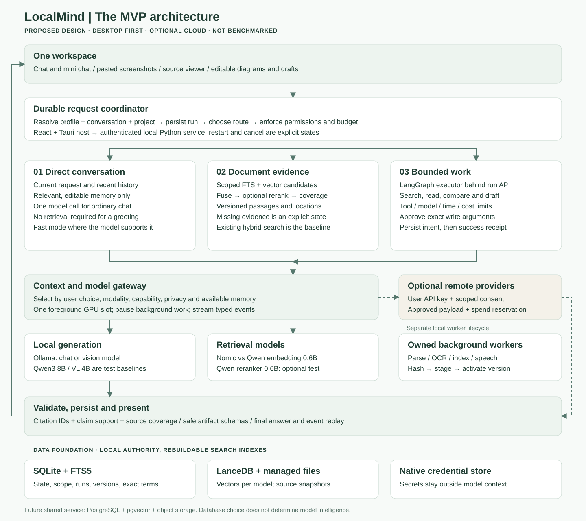

# LocalMind MVP: a private workspace for answers and finished work

**Design proposal, 14 November 2026. Not implemented or benchmarked by this research.** This narrows the [system design](../SYSTEM_DESIGN.md) into a buildable release. It assumes independent desktop installations, with optional user-supplied cloud API credentials. A shared hosted workspace is a separate deployment, not a requirement for using the desktop app.

## The product we should ship

For the expanded 60-component drawing, numbered request path, interface contracts and first implementation slices, see the [MVP build blueprint](MVP_BUILD_BLUEPRINT.md).

LocalMind should let someone ask a normal question, work through their own files and screenshots, and turn an answer into something useful: a comparison, a diagram, a draft, or a reviewed task. It should preserve the active conversation, show evidence when evidence matters, and recover when a model or service fails.

The MVP is an application architecture around pretrained models. It is not a newly trained foundation model. Downloading chat datasets, changing the database, or adding several agents does not itself make an 8B model reason like a frontier model. We need to measure model capability and application behavior separately.

## What the attached plan gets right, and what our source changes

The supplied plan correctly separates indexing, retrieval, generation, and bounded agent execution. Its prose already says that a valid citation ID does not prove support for a claim, and that deleted sources must become ineligible immediately. Preserve those requirements even though the simplified diagrams cannot show every check.

The plan's proposed starting work partly exists in this checkout. In [knowledge.py](../../services/ai/app/db/knowledge.py), LocalMind already creates SQLite FTS5, runs project-filtered LanceDB search, fuses ranks, and retains text search when embeddings fail. [context_retrieval.py](../../services/ai/app/context_retrieval.py) already resolves saved-chat ownership and applies topic-follow-up heuristics. Extend and measure these implementations rather than introduce parallel versions.

Concrete gaps observed in source:

- The vector schema and embedding validator hard-code 768 dimensions. A different embedding family needs a new index even when it happens to emit the same number of dimensions.
- Reindexing deletes the previous source's vectors before replacing its text rows. Separate stores do not provide one atomic replacement. A generation manifest must control visibility.
- Retrieval catches vector failures and continues with text, but callers need a structured degraded-search status rather than an indistinguishable result list.
- The context path requests five passages. A multi-document comparison needs explicit evidence coverage and a budget, rather than assuming five nearest matches cover both documents.
- Conversational topic resolution uses bounded lexical heuristics. Test ambiguous follow-ups across varied subjects and languages; do not teach it only the backpropagation example.

These observations are from the local files, not a new running-app reproduction. The old screenshots do not identify which build was installed.

## Selected stack and deployment

Use React/TypeScript and the existing Tauri host for the first implementation. Keep Python/FastAPI as a modular service with one owner per profile. Add a typed run coordinator and a LangGraph executor for bounded multi-step research; ordinary chat bypasses the graph. Preserve app-owned run IDs and event schemas so graph checkpoints do not become the public API. LangGraph supports persisted execution state, but tool idempotency and authorization still belong to LocalMind. [Persistence documentation](https://docs.langchain.com/oss/python/langgraph/persistence).

Keep Ollama as the first local inference adapter. Keep the existing cloud adapters and native credential storage. Add capability-aware dispatch, not a second provider subsystem. Compare direct llama.cpp only if equivalent-model measurements show a meaningful improvement after startup and packaging costs. vLLM is an optional user-operated GPU server adapter, not a mandatory desktop dependency. [vLLM installation](https://docs.vllm.ai/en/stable/getting_started/installation/gpu/).

The service remains one deployable application with separate owned workers for parsing, OCR and speech. No Docker installation is required for the desktop MVP. A Tauri-to-Electron or Python-to-TypeScript pivot remains possible if a packaged vertical-slice test demonstrates a better result. It is not a prerequisite for fixing routing or retrieval.

## SQLite is optional; each store has a different job

**Decision: retain SQLite for local transactional state, FTS5 for lexical retrieval, and LanceDB for rebuildable vectors.** This is a workload decision, not a claim that other databases are unnecessary. The desktop has one profile owner and small transactions. SQLite supports this embedded workload; many simultaneous writers or direct network clients favor a client/server database. [SQLite deployment guidance](https://www.sqlite.org/whentouse.html).

| Responsibility | MVP choice | Reason and replacement trigger |
|---|---|---|
| Chats, projects, source manifests, memory revisions | Existing SQLite domain stores | Durable local records with no database daemon. Introduce schema migrations and consistent backup/restore. Revisit if measured writer contention persists after short transactions and ownership fixes. |
| Runs, events, tool intents and receipts | New `runs.db`, WAL, bounded transactions | Commit run transitions and their outgoing events together. Preserve current stores during migration; do not imply atomic commits across all files. |
| Exact terms and identifiers | Existing FTS5 | Already integrated, useful offline when the embedding runtime is unavailable. Verify FTS5 in each packaged platform. |
| Semantic candidates | Existing LanceDB, collections per embedding fingerprint | Rebuildable index rather than authority for permissions or document existence. LanceDB also supports hybrid search; consolidating lexical search there is an alternative experiment, not a second concurrent implementation. [Embedded hybrid search](https://docs.lancedb.com/oss/v0-41-0/search/hybrid-search). |
| Original files, extracted snapshots, artifacts | Managed local files with content hashes and retention policy | Large bytes need not live inside database rows. Referenced paths are app-managed and profile-scoped. |
| API credentials | Existing native credential store | Keep secrets outside prompts, normal logs and exported projects. |
| Optional tabular analysis | DuckDB worker, after core MVP | Useful for analytical queries over imported tables. It does not replace conversations, permissions or the run ledger. |

**If we launch shared cloud workspaces:** choose PostgreSQL for relational state, PostgreSQL full-text search plus pgvector for initial retrieval, object storage for files, and a durable job runner. Add tenancy, membership, row-level enforcement, backups and deletion semantics before sync. pgvector supports exact and approximate search; filtering an approximate index can reduce returned candidates, so test scoped recall and tune iterative scans or partitioning. [pgvector documentation](https://github.com/pgvector/pgvector).

**If local vector search becomes the bottleneck:** benchmark Qdrant Edge against LanceDB with the same corpus, metadata filters, memory ceiling, startup time and deletion tests. Qdrant has an embedded Edge option as well as its server deployment, so it is not accurate to dismiss it as cloud-only. Its documentation currently labels Edge beta; API stability, native package compatibility and operational cost remain to be tested. [Qdrant Edge](https://qdrant.tech/documentation/edge/).

The checkout pins LanceDB 0.20.0; the current embedded documentation examined describes 0.41.0. An upgrade needs API, migration and packaged-wheel tests. Do not assume current documentation proves a feature is available in our pinned build. PostgreSQL can also run on a user's machine, but operating another database service would need a concrete benefit for this desktop product.

We do not need a graph database to store memory relationships. Start with versioned edges in relational storage. Introduce a dedicated graph engine only when measured traversal workloads justify it. A vector index, a graph store and an LLM are different components; none is a substitute for the others.

## Model architecture: roles, not a swarm on every message

| Role | First candidate | How it is used |
|---|---|---|
| Everyday conversation and explanation | Installed Qwen3 8B as the baseline; compare a smaller instruction model on lower-memory devices | One generation call for ordinary turns. Use supported non-thinking mode for greetings and simple edits; reserve deeper reasoning for appropriate requests. This is a baseline, not a claim that it is today's best model. |
| Hard reasoning and higher-quality writing | Explicitly selected supported frontier API model | Same context and tool contracts as local inference, with destination disclosure, scoped consent and a spend reservation. Never silently escalate a local-only request. |
| Screenshot understanding | Qwen3-VL 4B Instruct candidate | Only for image turns. Compare against the existing vision baseline using small text, crops, charts and uncertainty cases. An ordinary text-only 8B model must not receive an image and pretend to see it. |
| Embeddings | Existing nomic baseline versus Qwen3-Embedding-0.6B | Background document indexing and query embedding. Store exact model revision, dimensions, pooling, normalization and instruction template in the index fingerprint. |
| Passage reranking | Qwen3-Reranker-0.6B candidate | Score a bounded shortlist only when evaluation justifies its latency. Fall back to fused ranks on deadline or resource pressure. |
| Speech | whisper.cpp transcription candidate; platform speech output first | Push-to-talk with editable transcript, then the normal chat pipeline and interruptible playback. Speech models are not additional reasoning agents. |

Model evidence: [Qwen3 8B](https://huggingface.co/Qwen/Qwen3-8B), [Ollama thinking controls](https://docs.ollama.com/capabilities/thinking), [Qwen3-VL 4B](https://huggingface.co/Qwen/Qwen3-VL-4B-Instruct), [embedding model](https://huggingface.co/Qwen/Qwen3-Embedding-0.6B), [reranker](https://huggingface.co/Qwen/Qwen3-Reranker-0.6B), [whisper.cpp](https://github.com/ggml-org/whisper.cpp). Check the exact distributed model files, license and runtime compatibility before packaging. No candidate was downloaded or benchmarked for this document.

Qwen's embedding card describes up to 1024 dimensions and configurable output sizes. Even selecting 768 does not make its vectors compatible with nomic's existing vectors. Rebuild into a separate collection, test it, then change the active pointer; retain the old index for rollback until the new one passes.

Do not load all these models together. Keep a foreground generation slot; pause background embedding work and release GPU leases before network waits or user approval. Measure model loading, input processing, thinking and output generation separately. The user's 15–20 second greeting could involve loading, CPU execution, thinking or application overhead; we have not diagnosed its exact cause from the transcript.

The first hardware matrix should include CPU-only, the user's measured GPU configuration, and an Apple Silicon machine. Record total RAM, available VRAM/unified memory, quantization, context length and concurrent work. A 5.2 GB download does not establish the runtime memory requirement. Recommend a preset only after it passes that device class's quality and latency gate.

## The online request path

1. **Accept and persist.** Create `run_id` and an idempotency key. Resolve profile, conversation and project from owned records. Capture attachment IDs, enabled tools, selected model, consent revision and request deadline. Emit an acknowledged event before expensive work.
2. **Choose a route.** UI intent and capability rules constrain the route. Ordinary conversation uses current history directly. Documents use retrieval; current facts use permitted live tools; images use a vision-capable model. Ambiguous complex requests may use one bounded structured planning call. The model may propose work but cannot enlarge permissions.
3. **Assemble context.** Protect the latest user request and recent conversation. Add only relevant, permitted memories and evidence within a model-specific budget. Keep tool output separate from instructions. Summaries carry provenance and may be corrected; they are not authoritative user facts.
4. **Retrieve or execute bounded reads.** Use the evidence pipeline below, or a typed tool result. Search failure, no matches, stale evidence and access denied are distinct outcomes. Date filters apply to time-sensitive questions, not greetings or timeless explanations.
5. **Generate and stream.** Pass current capability results so the model can say what the app actually did. Stream structured events for status, text, artifacts and usage. The UI shows progress rather than exposing internal prompt scaffolding.
6. **Validate and finish.** Resolve citations against the supplied evidence, check artifact schemas, persist the final answer and terminal event, and settle or hold the spend reservation. Cancel reaches workers and providers where supported. A disconnected UI can replay events by sequence number.

A structured route might be `chat`, `document_answer`, `current_information`, `image_answer`, or `bounded_task`. Do not classify every turn with another LLM call. Explicit user choices and known modality requirements should avoid needless latency. Test routing on mixed requests, ambiguous follow-ups and topic changes, not only matching keywords.

## Evidence pipeline and index lifecycle

**Ingestion:** scoped file reference → hash and version → parse → structural passages with page/line/table coordinates → stage text/FTS and embeddings → validate counts and metadata → activate a generation manifest.

Use existing text/PDF extraction for the baseline. Evaluate Docling in an optional owned worker for layout-sensitive PDFs, tables and OCR; its parser supports those formats, but packaging footprint, OCR accuracy and resource limits need LocalMind tests. Never fetch model weights unexpectedly while opening a user's first file. [Docling](https://github.com/docling-project/docling).

The manifest contains `document_id`, `content_hash`, `parser_revision`, `chunker_revision`, `embedding_fingerprint`, index readiness and active generation. Every result includes `project_id`, `document_id`, `generation_id`, `passage_id`, location and original text hash. A model cannot choose those ownership fields.

For a planned full-hybrid generation, switch visibility only when both indexes are ready. If embeddings are unavailable, a separately recorded lexical-only generation may become active with a visible degraded state; do not mix old vectors with new text or call it a complete hybrid index. On a failed update, an allowed previous snapshot may remain readable, explicitly labeled older. On deletion or revoked scope, make it ineligible immediately and invalidate caches; retaining a previous snapshot is not permission to retrieve it. Recheck eligibility before context assembly, before cloud dispatch and on citation opening. Content already sent to an authorized remote provider cannot be recalled retroactively.

**Retrieval:** original question + at most one scoped follow-up rewrite → lexical and semantic candidates → deduplication by passage identity → rank fusion → optional reranker → evidence diversity/coverage selection → context budget.

Use 20 candidates per retrieval branch, a rerank shortlist of 20, and up to 8 selected passages as initial experiment settings, not fixed quality guarantees. Compare these against the existing five-passage path. Preserve identifiers in rewrites and fall back to the original on failure. Multi-source tasks carry required source coverage; a summary of one file is not a completed comparison of two.

Separate three checks:

- **Reference validity:** does the citation resolve to a supplied, permitted source version?
- **Claim support:** does that passage support the specific claim, including numbers, dates and qualifiers?
- **Completeness:** did the answer cover the question's requested sources and missing information?

Deterministic ID checks are necessary but cannot establish semantic support. Use a labeled evaluation set and sampled human review; optionally use a separate evaluator for complex reports, calibrated against human labels. Do not market an LLM's self-check score as certainty. ALCE explicitly evaluates correctness and citation quality as distinct dimensions. [ALCE paper](https://arxiv.org/abs/2305.14627).

Keep generated contextual descriptions separate from quoted source text. They can improve retrieval experiments but must not be cited as original evidence. Contextual Retrieval is a useful comparison; its reported results are not LocalMind results. [Anthropic study](https://www.anthropic.com/research/contextual-retrieval).

## Bounded work, connectors and recovery

The first graph performs research reads and synthesis: resolve scope → plan required evidence → search/read → assess coverage → answer or explain the gap. Start with one coordinator, at most six tool calls, four model calls, and a 90-second deadline for the interactive research preset. These are proposed controls to tune, not claims of optimal limits. Check cancellation and budgets before every call, including retries. Stop repeated identical calls that add no evidence.

Initial tools are `search_project_docs`, `read_source_passage`, and one configured read-only connector. Keep external search and document content untrusted. A general MCP broker must validate tool schemas, allowed destinations, result size, timeouts and credentials. Installing an MCP server is not the same as trusting its suggested actions.

For a write, first persist an exact proposal: destination, arguments, revision, idempotency key and expected consequence. The user approves those arguments; any change invalidates that approval. Record intent before dispatch and a receipt after success. After a timeout, query provider state or ask for reconciliation rather than automatically repeat a non-idempotent operation. The existing reviewed LocalMind task action is the first write; broad email/file manipulation is later scope.

Run state: `accepted → preparing → queued → running → completed`, with `waiting_approval`, `cancelling`, `cancelled`, `interrupted`, `failed`, and `needs_reconciliation` as explicit branches. Persist transitions and an event outbox in one transaction. Leases recover abandoned jobs; they do not make an external write exactly-once. Redact secrets and default traces to IDs, timings and error categories rather than raw files or chats.

A read-only two-worker comparison is a later experiment. Ship it only if the same tasks improve enough to justify added latency, cost and failure modes. The benefit must come from separable work, not giving several copies of one small model different job titles.

## User experiences and useful advanced work

Three core MVP journeys establish the product:

1. **Explain, follow up, visualize.** A conversation keeps its subject across turns. A screenshot can be pasted and previewed. The user can ask for an editable graph or chart in a side workspace. Use typed graph/chart data and a controlled renderer; arbitrary generated JavaScript is outside the MVP execution boundary.
2. **Compare a project using evidence.** “Compare these two proposals, identify contradictory dates, and give me a decision brief.” Return a comparison, source passages, unresolved contradictions and an editable draft. This is the main document benchmark and demo.
3. **Read a connected source and prepare a task.** Inspect one explicitly authorized source, combine it with permitted project material, and propose a LocalMind task with an approval and receipt. A crash must not lose the request or duplicate its action.

Additional use cases fit the same design, with separate acceptance gates:

| Use case | Technical work beyond simple chat | Release position |
|---|---|---|
| Change-impact brief: what changed between two versions and which decisions may be affected? | Version diff, source-to-claim links, invalidate derived summaries, user review of inferred impact | First expansion after core evidence path |
| Screenshot-to-explanation and editable system diagram | Vision/OCR, grounded region references, graph schema, safe rendering, active-topic continuity | Core MVP, limited to supported artifacts |
| Spreadsheet investigation: which rows explain a total? | Typed read-only table operations, reproducible calculations, row/cell citations | Next increment; no arbitrary generated code |
| Meeting notes to decisions and tasks | Transcription timestamps, editable speaker/decision attribution, reviewed writes | Voice pilot after core MVP |
| Research that combines private documents with the web | Per-source outbound consent, query preview/redaction, dated evidence, conflict handling | Gated extension of document workflow |
| Evidence-backed learning session | User-selected documents, exercises, correction history and explicit learning preferences | Product experiment, not a claim of learning model weights |

These are useful combinations, not claims that no other product has implemented them. The research opportunity is to measure whether visible evidence, correct context and reliable local execution make these tasks better for our users.

UI states must distinguish starting the service, loading a model, searching, reading, writing a draft, awaiting approval, partial results and failure. Show the chosen model, source coverage and cloud destination where relevant. Keep advanced execution details collapsible. Never substitute “no evidence” for a crashed provider. Make the updater and diagnostics usable even if the AI process is down.

Push-to-talk can enter a release once transcript editing, microphone permission, cancellation and native packaging pass. Full duplex voice, image generation, video generation and an unrestricted plugin marketplace are not blockers for the core MVP. Preserve existing media quality gates rather than enabling weak output to enlarge the feature list.

## Research choices: what earns an experiment

| Technique | Evidence | Decision for LocalMind |
|---|---|---|
| Hybrid retrieval and reranking | [Qwen embedding/reranking report](https://arxiv.org/abs/2506.05176) | Existing fusion is baseline. Compare a small reranker and new embeddings independently, with dimensions and model versions isolated. |
| Better use of limited context | [Lost in the Middle](https://arxiv.org/abs/2307.03172) | Test placement and coverage rather than simply filling a larger context window. Findings from the paper's models do not establish today's LocalMind performance. |
| Contextual chunk representations | [Late Chunking](https://arxiv.org/abs/2409.04701) | Later controlled experiment. Requires token-level embedding/pooling support; cannot be achieved by renaming ordinary chunk embedding. |
| Global questions across a corpus | [GraphRAG](https://arxiv.org/abs/2404.16130) | Use when users actually ask corpus-wide theme questions. Benchmark structured summaries first; graph extraction adds indexing cost and inferred relationships need provenance. |
| Retrieval and reflection learned by a model | [Self-RAG](https://arxiv.org/abs/2310.11511) | Research reference, not a prompt-only drop-in upgrade. Its learned mechanisms should not be advertised as implemented by our generic agent loop. |
| Citation quality evaluation | [ALCE](https://arxiv.org/abs/2305.14627) | Separate support and completeness from valid links. Add contradictory, stale, absent and misleadingly similar evidence. |

The prior [repository study](../research/product-patterns-2026-11.md) covers Life, Jan, LibreChat and Open WebUI. Those examples inform provider boundaries, session ownership and recovery. Their stars and feature lists do not establish quality on our hardware or workloads. This document adds database documentation, model cards and primary research; it does not claim to have audited every repository or searched all literature.

## Delivery sequence and release evidence

This is a focused implementation slice of the [40-story proposal](IMPLEMENTATION_PLAN.md), not 12 extra stories added to an unknown remaining-backlog total.

1. Freeze current behavior and save labeled conversation, document and screenshot fixtures. Record stage timings without private payloads.
2. Persist accepted runs and ordered events. Verify disconnect/restart/replay and updater independence.
3. Introduce model capabilities and route contracts. Prove greetings avoid retrieval and unsupported image requests fail usefully.
4. Add index fingerprints and generation manifests. Verify deleted sources, interrupted reindexing, embedding changes and rollback.
5. Measure existing hybrid retrieval, then reranking and scoped rewriting separately. Select by held-out results.
6. Add evidence coverage, source navigation and explicit partial/missing states. Test citations against exact versions.
7. Complete the common local/cloud response contract, outbound consent and unknown-charge handling.
8. Add the bounded document graph, checkpoints, limits and cancellation. Prove it improves multi-source tasks over a single retrieval call.
9. Complete screenshot-to-artifact flow and keyboard-accessible artifact editing/export.
10. Connect one read-only MCP source and the existing reviewed task write with receipts.
11. Run packaged startup, recovery, upgrade and data migration tests across supported operating systems. Add push-to-talk only after its own native checks.
12. Run held-out model evaluations and user task trials; release only the capabilities that pass.

Start with **240 distinct held-out multi-turn scenarios**, 40 per category: ordinary chat/topic changes; document retrieval; conflicting/missing evidence; screenshots/artifacts; tools/consent; interruption/recovery. Keep development cases separate. Add all previously reported failures as regressions in development and include new analogous held-out cases. Thousands of paraphrases can stress a system but do not constitute thousands of independent quality tests. This corpus is evaluation data, not training data.

Proposed release gates, to be frozen before the final run:

- Zero observed cross-profile/project leaks, unauthorized sends, fabricated action receipts or deleted-source retrieval in deterministic and adversarial fixtures. This is a test gate, not proof that all possible attacks are impossible.
- At least 90% of labeled evidence passages retrieved within the top 10; separately report all-required-source coverage on multi-source questions.
- At least 90% supported substantive claims in the grounded-answer set, plus separately reported missing-answer and over-abstention rates. Human-label a sample and inspect every critical failure; a model judge alone cannot certify quality.
- At least 85% complete user tasks on the frozen MVP suite, with results broken down by model/preset, route and difficulty rather than a pooled score that hides failures.
- Foreground status acknowledgment p95 under 300 ms in the local test harness. Initial target for warm ordinary-chat first useful text: p95 under 4 seconds on the declared reference machine, excluding explicit deep-reasoning mode. Cold start, document and vision latency are reported separately. Targets are unmeasured and must not appear as product claims.
- Installer, migration, cancellation and restart journeys pass on every advertised platform. Every cloud adapter has deterministic contract tests; live checks require explicit credentials and spend limits.

PR CI should run pure routing/context tests, temporary-database lifecycle tests, fake-provider/tool contract tests, event replay, permission and artifact tests. Nightly or manual jobs run pinned local-model evaluations, fault injection and native package tests. Paid API evaluations stay budgeted and explicit. Increase meaningful coverage, not pipeline length for appearance.

Keep measurements reproducible: source commit, corpus version, model digest, runtime version, prompts, quantization, hardware, context limits and stage timings. Store generated reports locally by default and publish only a deliberately reviewed summary. Existing code and tests remain version-controlled.

## What would change this decision

Choose PostgreSQL now if the product decision changes to shared hosted workspaces with concurrent users and central administration. Choose Qdrant if a scoped retrieval benchmark beats the embedded baseline enough to pay for migration. Choose another desktop host if packaged reliability improves. Choose a stronger model or opt-in API when controlled comparisons show that the current model cannot perform the task despite correct context.

The first implementation should prove one complete journey: import two documents, ask a comparison, open its evidence, save a reviewed task, restart the app, and recover the result. That produces product evidence for the next architectural decision.
