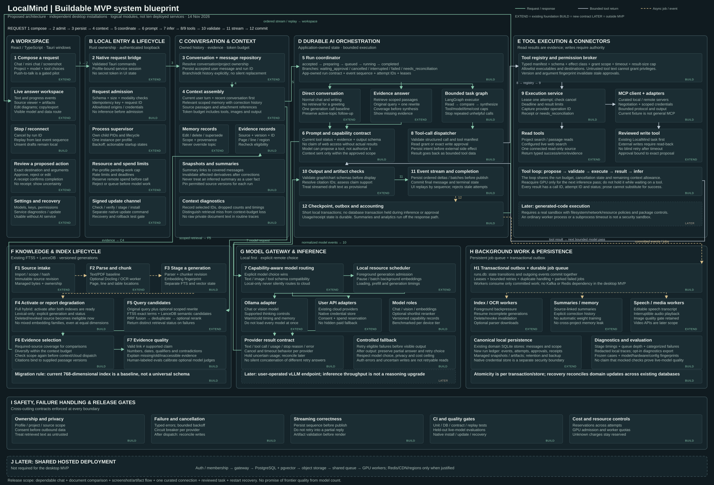

# LocalMind MVP build blueprint

**Proposed design, not implemented functionality.** Prepared 14 November 2026 from the supplied AI-chat reference, the local code inspection and [MVP architecture research](MVP_ARCHITECTURE.md).

This is the detailed build view of that MVP. It retains independent desktop installations and optional user-provided model APIs. The diagram contains 60 component boxes across ten sections; these are responsibilities inside a small number of processes, not 60 services to deploy.

Open the SVG directly to zoom into labels. `EXTEND` means an existing foundation needs work, `BUILD` means a proposed contract or component, and `LATER` means outside the core MVP. A label does not certify that every behavior inside an existing component works today. Solid green arrows show request/response handoffs, pale arrows show the bounded tool flow, and dashed gold arrows show asynchronous work. Supporting modules without an arrow share the section's owner; the drawing is a responsibility map rather than an exhaustive sequence trace.

For section navigation, zoom and clickable components, open [the standalone architecture explorer](localmind-architecture.html) in a browser. It works offline from the file itself and does not require the Codex canvas viewer or a running server.

## What we adopt from the reference

Adopt its separation of client, request admission, conversations, context, orchestration, model serving, tools, retrieval and background processing. Preserve explicit cancellation, idempotency, streaming, limits and failure handling.

Translate its server infrastructure into the product we are building:

- The desktop's native request bridge and local service perform admission. A cloud API gateway, public authentication system, CDN and WAF are not needed to run a local chat.
- SQLite stores canonical local records; LanceDB is a rebuildable semantic index. A durable local queue and event outbox replace the need for Kafka in this deployment.
- Local GPU admission controls work on one user's device. Shared model servers, continuous batching and regional routing are a different deployment problem.
- Model API credentials identify the user's provider account. They do not create a LocalMind team identity or authorize a connector to access unrelated data.
- Output checks validate schemas and reference integrity. They cannot guarantee factual accuracy or retract text already streamed to the user.

The future hosted section uses PostgreSQL/pgvector and object storage. Redis, shared GPU workers, CDN delivery and multi-region operation are additions tied to a measured workload, not prerequisites for desktop reliability.

## Deployment and ownership

| Process or boundary | Responsibility | Implementation decision |
|---|---|---|
| Desktop host | Windows, clipboard, single instance, owned service lifecycle, signed updater | Existing Tauri/Rust, with React/TypeScript windows |
| Profile service | Conversation, run state, context, model/tool adapters, local API | Existing Python/FastAPI, refactored into modules |
| Bounded graph executor | Multi-step evidence gathering and synthesis | LangGraph behind app-owned state/event contracts; direct chat bypasses it |
| Inference runtime | Load weights and generate outputs | Ollama first; explicit cloud adapters remain optional |
| Owned workers | Parsing, optional OCR, indexing and speech | Isolated lifecycle, quotas and cancellation; not represented as a security sandbox |
| Local stores | Durable domain records, run ledger, files, indexes and secrets | SQLite/FTS5, LanceDB, managed files, native credential storage |

The service owns persistence. UI windows subscribe to state rather than race to save the final response. The run coordinator is the only writer of a run's transitions. Workers return results through a contract; they cannot independently authorize tools or mark a run complete.

Keep current domain stores during the migration. Add a run ledger and transactional outbox, then reconcile domain projections through idempotent writes. Do not claim a single transaction spans the existing conversation database, provider ledger, graph checkpoint store and filesystem.

## Numbered main request

1. The user submits text and owned attachment IDs from full chat or mini chat. A client-generated idempotency key identifies that submission, not every subsequent retry attempt.
2. The native bridge and service validate session, ownership, request shape, sizes, modality, queue capacity and enabled capabilities. Invalid requests fail before inference.
3. Persist acceptance, the request snapshot and a run ID. The user message and run projection use a recoverable relationship; interrupted projection writes are reconciled instead of producing duplicate submissions.
4. Resolve the active conversation and project. Assemble history, relevant memory, allowed source references and a token budget. Historical assistant errors never become authoritative capability descriptions.
5. The coordinator chooses direct chat, a document answer, or bounded work. Explicit UI choices and capability rules constrain any model-generated plan.
6. Build the model request from current instructions, scoped context, actual tool status and supported output schemas. Reserve cloud spend and check outbound consent before dispatch.
7. The model gateway routes to the explicitly chosen compatible provider. Local generation obtains a resource lease. Return typed text/tool/usage/error events rather than provider-specific frames leaking through the UI.
8. If a tool is proposed, validate the tool ID, schema, effect class, destination, remaining budget and current grant. A write needs approval bound to the exact arguments and revision.
9. Persist a tool intent, dispatch one attempt, and record the result or receipt. Release the GPU while waiting. Feed bounded tool data into another permitted inference pass; count all passes against the same run budget.
10. Validate artifacts before mounting them. Resolve citations against supplied sources. For grounded claims, report evidence gaps and evaluate support; a valid link is not proof of correctness.
11. Persist ordered output batches before exposing their sequence to subscribers. Save the terminal result. A disconnected client resumes from its last sequence without restarting generation or duplicating messages.
12. Commit accounting and completion records where owned, then schedule noncritical summaries, indexing and analytics via the outbox. Unknown provider charges remain reserved until reconciled.

These numbers describe the successful path. Every step also checks cancellation and can produce a typed failure. The coordinator must avoid an extra planning/model call for ordinary conversation.

## Contracts to implement first

Names below are proposed internal interfaces, not endpoints that already exist.

| Contract | Required fields and invariant |
|---|---|
| `RunRequest` | conversation/project references, user message, attachment IDs, model choice, enabled capabilities, idempotency key. Resolve ownership from stored records, never trust client-supplied owner IDs. |
| `RunRecord` | run ID, request snapshot hash, state, deadline, lease, attempt, last sequence and terminal reason. A terminal state cannot silently resume as the same generation attempt. |
| `RunEvent` | schema version, run ID, attempt ID, monotonic sequence, event type and typed payload. Unique `(run_id, sequence)` supports replay and duplicate rejection. |
| `EvidenceRef` | project/document/generation/passage IDs, text hash, location, eligibility revision and retrieval status. Citation resolution uses supplied IDs and current permissions. |
| `ModelRequest` | provider/model revision, modality, bounded context, tool schemas, output limit, consent revision and reservation ID. Explicit model selection wins over automatic fallback. |
| `ToolIntent` | tool and manifest revision, normalized arguments, destination, effect class, approval fingerprint and idempotency key. A changed proposal invalidates approval. |
| `ToolResult` | call/attempt IDs, success or typed error, provider operation ID, bounded output, evidence references and receipt. A timeout after dispatch is an unknown outcome, not proof of failure. |
| `IndexGeneration` | content/parser/chunker/embedding fingerprints, dimensions, readiness, active pointer and deletion state. Different embedding families never share a collection without a rebuild. |

Proposed local service surface: `POST /v1/runs`, `GET /v1/runs/{id}`, `GET /v1/runs/{id}/events?after={sequence}`, `POST /v1/runs/{id}/cancel`, and `POST /v1/actions/{id}/decision`. Keep the token inside the native host and relay events to both windows. Choose SSE or bounded event polling at that boundary after testing Tauri transport behavior; the contract must not depend on a browser owning a raw privileged WebSocket.

Use compatibility adapters around the current chat route while migrating. One run has one execution owner. Do not start the old chat flow and the new coordinator for the same user submission.

## Tool and retry behavior

| Situation | Required result |
|---|---|
| Local runtime not ready | Recoverable startup state with diagnostics; no fabricated assistant answer |
| Provider rate limit before output | Honor retry information within deadline, reservation and attempt limits |
| Invalid provider key | Actionable credential error; no repeated retry loop |
| Generation fails after visible output | Preserve the partial answer and mark it interrupted; user can retry as a distinct attempt |
| UI closes or reconnects | Reattach to the same run or its persisted terminal result |
| User presses Stop | Persist cancellation; stop new steps and cancel supported active work; preserve partial output |
| External write times out | `needs_reconciliation`; read back provider state or ask for resolution, never blindly resend |
| Tool grant is revoked | Recheck before dispatch and block queued work; do not authorize from cached approval alone |
| Source is deleted during retrieval | Exclude it before context/cloud dispatch and on source opening; invalidate derived retrieval caches |
| Worker crashes while indexing | Resume or restart the staged generation; retain only an eligible, explicitly older snapshot |

A retry is another attempt within a run's budget. A retry must not concatenate a fresh answer into an already visible one. A fallback may change price, capability and data destination, so it must obey explicit model choices and existing consent. No silent local-to-cloud escalation.

## What the MVP includes

Ship dependable multi-turn chat, optional user API keys, project document comparison with source navigation, screenshot input, controlled editable artifacts, one curated read-only connector, one reviewed task action, and restart/reconnect recovery. Keep model selection and indexing status understandable in the UI.

Push-to-talk and interruptible playback have a separate native acceptance gate. Full-duplex speech, arbitrary code execution, broad plugin installation, image/video generation improvements and multi-agent research teams are later work. Existing media functionality keeps its current quality gates.

The models and database alternatives remain those in the [MVP architecture](MVP_ARCHITECTURE.md). The larger drawing adds execution detail; it does not introduce a requirement to install every candidate or run every model at once.

## Start with these implementation slices

These refine the existing [implementation plan](IMPLEMENTATION_PLAN.md); they are not an additional claim about the total remaining backlog. Each slice should produce a reviewable change and tests.

| Order | Slice | Existing plan mapping | Completion evidence |
|---|---|---|---|
| 1 | Run/event contracts and baseline timing | A01–A03 | Versioned fixtures; stage timings; replay duplicate rejection |
| 2 | Run ledger, outbox and request idempotency | A03–A05 | Kill between acceptance and dispatch; restart produces one accepted request |
| 3 | UI subscription and durable final messages | A05–A07 | Full chat and mini chat observe one run; reconnect does not resend |
| 4 | Cancellation, leases and recovery | A08–A09 | Close window, stop model and kill worker at controlled boundaries |
| 5 | Local/cloud response and capability contracts | B01–B07 | Real adapter errors have typed outcomes; explicit model/privacy choices hold |
| 6 | Index generations and embedding migration | C01, C04 | Separate model fingerprints; deleted and partially indexed sources excluded |
| 7 | Evidence selection and bounded document workflow | C01–C05 | Two-document comparison covers both; failed retrieval is visible |
| 8 | Tool broker, curated MCP read and task receipt | C06–C10 | Injection/revocation tests; exact write approval; unknown outcome recovery |
| 9 | Screenshot and editable artifact journey | D, multimodal subset | Attachment ownership, compatible vision model, safe schema and source navigation |
| 10 | Packaged release acceptance | A10, B08/B10, D acceptance subset | Native install/update/recovery plus held-out task results per supported model/device |

**First end-to-end milestone:** send an ordinary message, close the window during generation, reopen it, and see the same saved run or an honest interrupted result. Then extend that run to compare two versioned documents and create a reviewed task. This tests the execution foundation before adding more autonomy.

## Validation and release gate

Reuse the substantial existing Python, frontend, Rust, database and native CI. Add deterministic run-transition, event-replay, idempotency, consent, source-generation and tool-contract tests. Inject failures before and after durable writes and external dispatch. Cover database migrations and backups with temporary profiles.

Keep nondeterministic model evaluations separate from PR unit tests. Use the proposed 240 held-out multi-turn scenarios from the MVP plan and report source coverage, grounded claims, complete tasks, latency and resource use by model and device. Do not declare all 60 boxes complete because a mocked happy path passes. Native package tests and live model/API tests remain separate evidence.

For this design artifact, verify SVG structure, text bounds, interactive-view types and local documentation links. No application behavior is changed or benchmarked by drawing the architecture.
